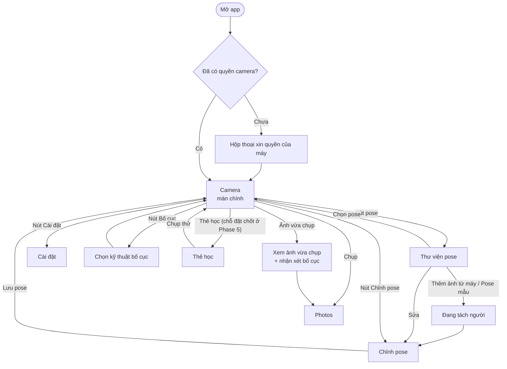
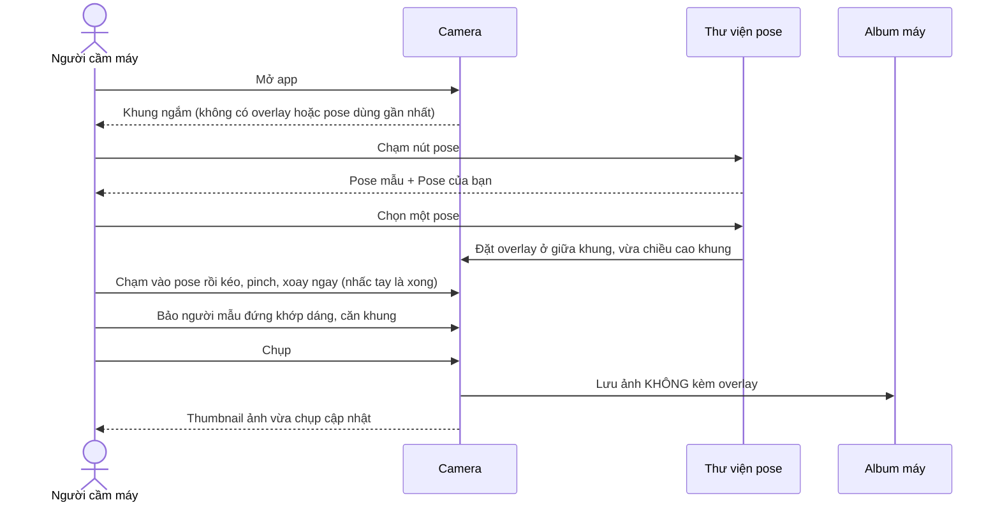
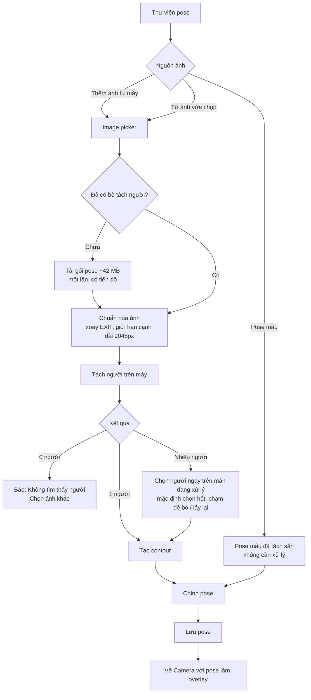
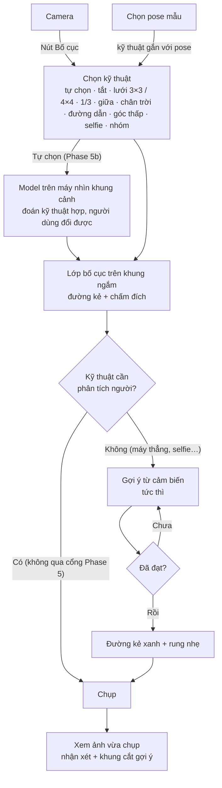
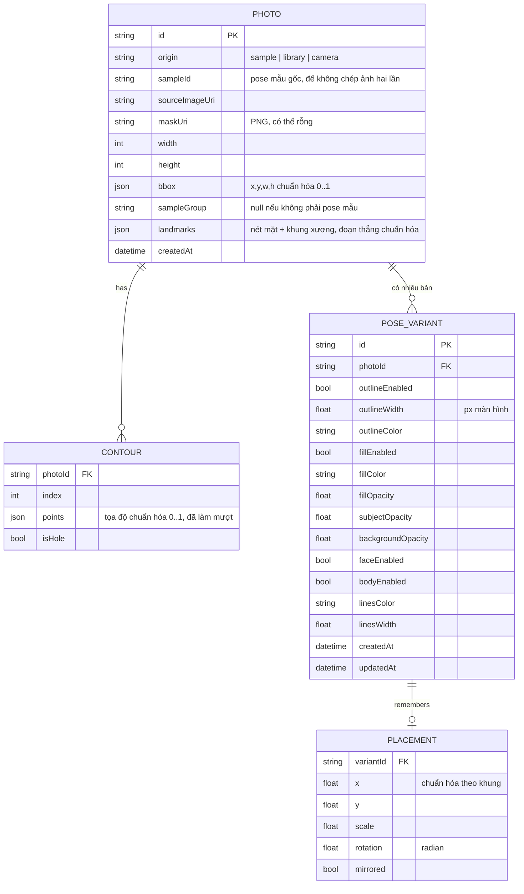
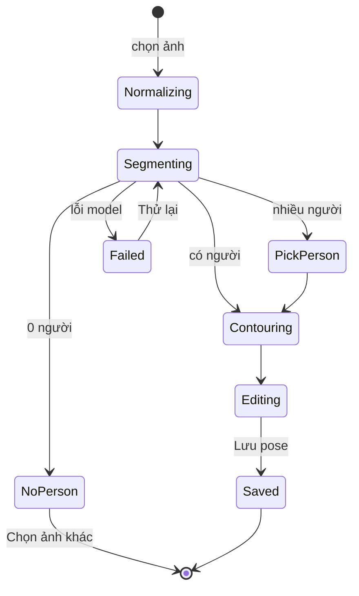
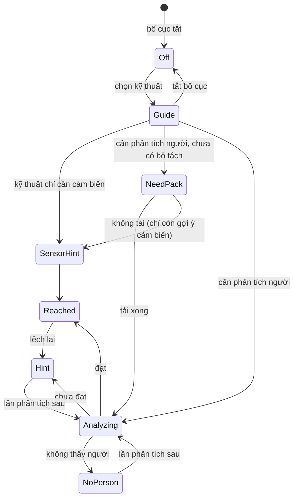

# SnapShot — Business flow

> Tài liệu nghiệp vụ cho bản rebuild. Mô tả **app làm gì, cho ai, theo luồng nào và theo quy tắc nào**.
> Cách làm kỹ thuật ở [roadmap.md](roadmap.md), giao diện ở [design.md](design.md).

---

## 1. Sản phẩm trong một câu

**SnapShot là app camera chụp theo dáng mẫu:** tách dáng người từ một ảnh mẫu, đặt dáng đó lên khung ngắm làm lớp hướng dẫn, rồi chụp người thật theo đúng dáng. Cùng lúc, **trợ lý bố cục** hướng dẫn đặt người ở đâu trong khung và cầm máy góc nào theo các kỹ thuật của nghề ảnh, kèm thẻ học từng kỹ thuật.

Phạm vi v1: **iOS và Android (chạy trong Expo Go), chỉ tiếng Việt, chạy hoàn toàn trên máy, không có server**, là đồ án portfolio.

### Người dùng

| Vai trò | Họ cần gì | Dùng chức năng |
|---|---|---|
| **Người cầm máy** (bạn bè, người yêu, nhiếp ảnh nghiệp dư) | Biết cần bảo người mẫu đứng thế nào, căn khung ra sao | 1 — Chụp theo pose, 3 — Trợ lý bố cục |
| **Người được chụp** | Xem nhanh dáng cần tạo, so với dáng mình đang đứng | 1 — Chụp theo pose |
| **Người sưu tầm dáng** (content creator, người hay chụp ảnh du lịch) | Lưu dáng đẹp thấy trên mạng thành thư viện riêng | 2 — Tạo và chỉnh pose |
| **Người mới tập chụp** | Biết đặt người ở đâu trong khung, cầm máy góc nào, tránh lỗi hay gặp; học dần kỹ thuật | 3 — Trợ lý bố cục |

---

## 2. Thuật ngữ (dùng thống nhất trong code, UI và tài liệu)

| Thuật ngữ | Nghĩa | Tên trong code |
|---|---|---|
| **Ảnh nguồn** | Ảnh gốc có người, dùng để tách dáng | `sourceImage` |
| **Mask** | Ảnh alpha 1 kênh: 255 = người, 0 = nền | `mask` |
| **Contour** | Đường bao vector của mask, đã làm mượt | `contours` |
| **Ảnh gốc** | Ảnh có người đã tách: viền + nét mặt + khung xương; dùng chung cho mọi bản pose của nó | `photos` |
| **Pose** (bản pose) | Một ảnh gốc + một bộ style. Một ảnh gốc có thể có nhiều bản | `Pose`, `pose_variants` |
| **Nét mặt / nét tay chân** | Đường vẽ viền mặt, mắt, mũi, môi / khung xương thân, tay, chân | `style.faceEnabled`, `style.bodyEnabled` |
| **Lớp viền** | Nét vẽ theo contour (bật/tắt, độ dày, màu) | `style.outline` |
| **Lớp phủ** | Màu phủ lên vùng mask (bật/tắt, màu, độ đậm) | `style.fill` |
| **Lớp người** | Phần ảnh người thật đã tách (độ hiện) | `style.subject` |
| **Overlay** | Pose đang hiện trên khung ngắm, kèm vị trí/tỉ lệ/góc xoay | `OverlayState` |
| **Kỹ thuật bố cục** | Một kỹ thuật của nghề ảnh mà app hướng dẫn (quy tắc 1/3, góc thấp…), danh mục ở [composition.md](composition.md) | `CompositionTechnique` |
| **Lớp bố cục** | Đường kẻ và chấm đích của kỹ thuật đang chọn, vẽ trên khung ngắm | `CompositionGuide` |
| **Gợi ý** | Một câu ngắn kèm mũi tên chỉ cách chỉnh (dời máy, nghiêng máy, lùi ra) | `Hint` |
| **Nhận xét** | Kết quả phân tích bố cục của ảnh vừa chụp | `CompositionReview` |
| **Thẻ học** | Giải thích một kỹ thuật: ảnh đúng / sai, vài câu, nút Chụp thử | `Lesson` |

Trong UI chỉ dùng chữ **"pose"**. Không dùng "segment" hay "form" (bản cũ dùng tên "Danh sách Form").

---

## 3. Bản đồ màn hình

Camera là màn gốc: mọi màn khác mở từ Camera và đóng lại về Camera. Khung giao diện chung ở [§7.3](#73-khung-giao-diện-chung), làm ở [roadmap Phase 4](roadmap.md#phase-4--giao-diện-chụp-ảnh-và-giao-diện-chung-12-tuần).

---

## 4. Chức năng 1 — Chụp theo pose

### 4.1 Luồng chính

### 4.2 Thao tác trên khung ngắm

Bản cũ giật vì mọi cử chỉ chồng lên nhau. Bản mới quyết định theo **chỗ ngón tay đầu tiên chạm xuống**, giữ nguyên cho cả lượt chạm (đến khi nhấc hết ngón):

| | **Lượt chạm bắt đầu trên pose** | **Lượt chạm bắt đầu ngoài pose** |
|---|---|---|
| 1 ngón kéo | Di chuyển overlay ngay, không cần bật chế độ chỉnh | — |
| 2 ngón pinch | Phóng/thu overlay quanh tâm hai ngón | Zoom camera |
| 2 ngón xoay | Xoay overlay (hít về 0° khi lệch dưới 3°, rung nhẹ) | — |
| Chạm 1 lần | — | — (camera tự lấy nét; `expo-camera` không có lấy nét theo điểm chạm) |
| Chạm đúp | Đặt lại vị trí/tỉ lệ/góc ban đầu | — |
| Kéo vào vùng xóa | Vùng xóa ăn theo **ngón tay**: ngón vào vòng tròn thì viền `danger`, rung cảnh báo, overlay mờ và thu nhỏ về phía thùng rác. Thả tay lúc đó thì overlay mờ hẳn rồi bị gỡ; kéo ra khỏi vòng thì trở lại như cũ | — |
| Thanh điều khiển | Điều khiển dưới và rail mờ đi, vùng xóa hiện ra trong lúc kéo | Hiện đủ |

- Vùng nhận cử chỉ là **cả màn hình** (dưới các nút), nên pose kéo ra ngoài khung ngắm vẫn chỉnh tiếp được.
- Pose là lớp trên cùng của ảnh (nằm trên cả vùng nền đặc ngoài khung) nhưng dưới các nút điều khiển.
- Pinch và xoay chạy cùng lúc. Kéo, pinch và xoay đều cộng dồn từ trạng thái trước, không bao giờ nhảy về giá trị cũ.

### 4.3 Điều khiển camera

| Điều khiển | Giá trị | Ghi chú |
|---|---|---|
| Đổi camera | sau / trước | Camera trước: preview soi gương, ảnh lưu không soi gương (theo cài đặt) |
| Flash | tắt / bật / tự động | Dùng flash gốc của camera, không dùng đèn pin |
| Bố cục (thay nút Lưới, Phase 5) | tắt / lưới 3×3 / lưới 4×4 / một kỹ thuật bố cục ([§6](#6-chức-năng-3--trợ-lý-bố-cục)) | Mỗi lúc một lớp kẻ; vẽ trong vùng ảnh thật sẽ được lưu |
| Thước cân bằng | bật / tắt | Đổi sang màu nhấn khi máy lệch dưới 1° |
| Tỉ lệ khung | 3:4 / 9:16 / 1:1 | Khung ngắm hiển thị đúng vùng ảnh sẽ được lưu |
| Hẹn giờ | tắt / 3 s / 10 s | Cho người chụp tự đặt máy |
| Zoom | 4 nút nhanh 0,5 · 1× · 2 · 3; giữ và kéo ngang trên cụm nút thì thành thước 0,5×–5×, bước 0,1, thả tay về lại 4 nút (Phase 4) + pinch ngoài pose | Dưới 1× chỉ có trên iPhone có ống góc rộng (đổi ống qua `selectedLens`); camera trước và Android bắt đầu từ 1×. Số hiển thị là ước lượng vì `expo-camera` không cho đọc zoom tối đa thật |

### 4.4 Điều khiển nhanh cho overlay (khi đang có pose)

- **Chỉnh pose**: mở thẳng màn Chỉnh pose cho pose đang dùng (góp ý Phase 3). Lưu thì quay về Camera; lưu thành bản mới (hoặc sửa pose mẫu) thì Camera dùng luôn bản mới, giữ vị trí và lật ngang.
- **Độ hiện overlay**: chạm để đổi nhanh 100% / 60% / 30%. **Giữ nút** thì cột công cụ biến thành thanh kéo dọc gọn trong cột, kéo lên xuống bằng chính ngón đó (0–100%, tính theo quãng kéo), thả tay thì cột trở lại (góp ý Phase 4: mọi thao tác bằng một ngón, không phải với sang bên).
- **Lật ngang**: soi gương dáng (dáng tay trái thành tay phải).
- **Ẩn / hiện pose**: chạm để ẩn overlay, chạm lần nữa để hiện lại (Phase 4: thay cho giữ để ẩn), dùng khi cần nhìn rõ người thật. Đổi pose thì pose mới luôn hiện.
- **Gỡ pose**: kéo pose vào thùng rác để xóa overlay khỏi khung. Pose vẫn còn trong thư viện.
- **Cột công cụ dời được** (Phase 4): các nút trên nằm trong một cột dọc. Kéo cột lên xuống, quăng sang trái hoặc phải thì cột dính vào mép đó; cột luôn nằm trong khung ngắm và giữ vị trí cho lần mở sau. Thay cho chế độ tay trái.

---

### 4.5 Ảnh vừa chụp

- **Ảnh vừa chụp**: ô nhỏ bên trái nút chụp hiện ảnh mới nhất. Chạm vào mở màn **Xem ảnh vừa chụp**: các ảnh chụp trong lần mở app này, vuốt ngang để xem ảnh trước, có nút Chia sẻ và Xóa (xóa khỏi album, có xác nhận). Chưa chụp ảnh nào thì ô trống và không bấm được. Phase 5 thêm **nhận xét bố cục** cho từng ảnh ([§6.5](#65-nhận-xét-sau-khi-chụp)).
- **Phản hồi khi chụp**: mỗi lần bấm là một lần chớp màn và rung nhẹ.
- **Chụp liên tục** (Phase 4): bấm tiếp được ngay khi camera chụp xong, không đợi cắt và lưu. Bấm lúc camera đang chụp thì app nhớ **một** lần bấm và chỉ chụp nếu camera xong trong 0,25 s; không có hàng chờ lần bấm, nên camera không còn chớp sau khi người dùng đã ngừng bấm. Đổi camera giữa lúc chụp thì bỏ lần bấm đang chờ, đợi ảnh đang chụp xong rồi mới đổi; camera mới báo sẵn sàng mới chụp được. Ảnh được cắt và lưu vào album ở nền, từng ảnh một, ngay khi chụp. Trong lúc bấm liên tục, ô ảnh vừa chụp giữ ảnh cũ; ngừng bấm (khoảng 0,35 s) và lưu xong thì ảnh mới nhất bay vào ô, rung báo đã lưu. Tối đa 8 ảnh đang chờ; bấm thêm khi đang đầy thì bỏ qua. Lưu lỗi thì báo một lần sau đợt chụp theo [§10.3](#103-thông-báo-lỗi).

---

## 5. Chức năng 2 — Tạo và chỉnh pose

### 5.1 Luồng chính

**Chọn người** (ảnh có từ 2 người trở lên, góp ý Phase 4 vòng 6): không có màn riêng. Tách xong, ảnh trên màn đang xử lý thành chỗ chạm để chọn: mặc định chọn hết (phủ màu nhấn), chạm một người để bỏ (viền nét đứt), chạm lại để lấy lại. Danh sách bước có thêm bước **Chọn người** với số đã chọn và hai nút **Hủy** · **Dùng n người**. Chạm là tức thì vì viền từng người dựng sẵn một lần; dáng chỉ vẽ sau khi bấm Dùng. (Vòng 3–5 thử chọn người trong Chỉnh pose → Cọ nhưng mỗi lần chạm phải dò lại cả dáng, chậm 0,5–1 giây, nên bỏ.) Model chỉ phân biệt người / nền, nên mỗi vùng người liền nhau tính là một người; vùng chiếm từ 2% ảnh trở lên là một người, mảng nhỏ hơn (tay rời, tóc) gắn vào người gần nhất. Hai người chạm hoặc đè lên nhau thành một vùng, phải chọn cùng nhau rồi dùng cọ Xóa để bỏ bớt. Nét mặt chỉ giữ của những người được chọn; cọ Thêm vẫn hiện lại được người chưa chọn.

### 5.2 Màn Chỉnh pose — các lớp và điều khiển

Chỉnh trên **nền ô caro** (vùng trống). Thứ tự lớp từ dưới lên: **nền → người → phủ → nét mặt → viền**.

Ảnh hiện **đầy đủ trên một màn hình** (vừa khít khung xem, không phải kéo). Caro chỉ vẽ **bên trong khung ảnh** (vùng trong suốt khi độ hiện nền < 100%); phần khung xem ngoài mép ảnh để nền tối trơn, không lộ caro thừa.

| Tab | Lớp | Điều khiển | Khoảng giá trị | Mặc định |
|---|---|---|---|---|
| **Viền** | | Bộ chọn **[Viền | Mặt]**: chọn đang chỉnh cái nào; công tắc, độ dày và màu bên dưới đổi theo | — | Viền |
| | Viền | Bật/tắt · Độ dày | on/off · 1–12 px (theo pixel màn hình, giữ nguyên khi zoom overlay) | on · 3 px |
| | | Màu | 7 màu có sẵn + Bảng màu | Trắng |
| | Nét mặt | Bật/tắt · Độ dày | on/off · 0.5–5 px | on · 1.5 px |
| | | Màu | 7 màu có sẵn + Bảng màu | Trắng |
| **Phủ** | Phủ | Bật/tắt | on/off | on |
| | | Màu | 7 màu có sẵn + Bảng màu (chọn tự do, mã HEX, lấy màu từ ảnh, 6 màu gần đây) | Cam |
| | | Độ đậm | 0–100% | 40% |
| **Nền** | Người | Độ hiện của người trong ảnh gốc | 0–100% | 0% |
| | Nền | Độ hiện của nền trong ảnh gốc (phần ngoài người) | 0–100% | 0% |
| **Cọ** | Viền | Cọ **[Thêm | Xóa]** vẽ thẳng lên ảnh, hoàn tác / làm lại không giới hạn trong một lần sửa (hoàn tác hết là về viền lúc mở màn) | cỡ cọ 8–64 px | Thêm · 24 px |

- **Nét mặt cho biết hướng mặt:** có nét mặt (viền mặt, mắt, lông mày, mũi, môi) nghĩa là người mẫu quay mặt về ống kính; không có nghĩa là quay lưng. Khi không thấy mặt, ô "Mặt" trong tab Viền tắt (Phase 4 bỏ dòng ghi chú). Giới hạn của model: mặt nghiêng hẳn, cúi xuống hoặc bị tay che có thể không được nhận ra.
- **Viền và nét mặt chung tab nhưng chỉnh riêng:** mỗi cái có công tắc, thanh độ dày và màu riêng; không có thanh kéo nào đổi cả hai cùng lúc.
- **Tay chân nằm trên thân:** đã thử vẽ "ống tay, ống chân" (hai nét dọc tay chân, ước lượng từ khung xương + mask) nhưng nét chưa đủ tốt nên **đã bỏ** (góp ý lần 3). Muốn thấy tay chân đặt trên người thì tăng độ hiện người ở tab Nền.
- Nét mặt lấy từ MediaPipe FaceLandmarker. Ảnh toàn thân có mặt nhỏ thì app dò lại trên vùng đầu đã phóng to.
- Mọi thay đổi hiện ngay khi kéo slider, không có nút "Áp dụng". Khi sửa nét bằng cọ, viền được tính lại lúc nhấc ngón tay.
- **Cọ** (bản trước gọi là Sửa nét): cọ **Thêm** nhận ra người: app giữ dáng **mọi người** trong ảnh lúc tạo pose (`photos.original_contours_json`, kể cả người không được chọn). Nét tô chủ yếu lên người thì chỉ phần thuộc dáng người được thêm (tô lại vùng mặt đã xóa thì viền theo đúng dáng); người đang thiếu (chưa chọn, hoặc đã xóa gần hết) mà nét tô lộ ra từ 25% thì hiện cả người, kèm nét mặt. Nét tô chủ yếu lên nền thì nới viền theo nét cọ. Cọ **Xóa** bỏ đúng vùng tô; nét mặt nằm trên vùng đã xóa thì ẩn theo. Nét đang vẽ hiện mờ (màu nhấn = thêm, màu đỏ = xóa); nhấc ngón tay thì viền, phủ và ảnh người vẽ lại theo hình mới. Viền là của **ảnh gốc** nên đổi cho mọi bản của ảnh đó. Pose mẫu đã sửa nét được lưu thành một ảnh chép mới, không đổi các bản chép trước. Không lưu được nếu vùng người còn dưới 2% ảnh (BR-06).
- **Lưu:** "Lưu pose" ghi đè bản đang sửa; "Lưu thành bản mới" thêm một bản khác cho **cùng ảnh gốc**. Với pose mẫu chỉ có "Lưu pose", và nút này luôn thêm bản vào "Pose của bạn" (BR-09).

### 5.3 Thư viện pose

- **Ô pose luôn hiện ảnh gốc đầy đủ màu (người + nền)**: người dùng chọn pose nhờ nhìn cả người mẫu lẫn bối cảnh, để so với bối cảnh mình đang có.
- **Pose mẫu**: đi kèm app, chia nhóm (Quán cà phê, Trường học, Đường phố, Du lịch). Ô là ảnh gốc + viền trắng mảnh. Viền, nét mặt và tay chân đã tách sẵn nên chọn là dùng ngay.
- **Pose của bạn**: lưới phẳng, **mỗi bản pose một ô**, sửa gần nhất trước. Ô là ảnh gốc + style của chính bản đó (phủ, viền, nét), nên các bản từ cùng một ảnh vẫn phân biệt được. Chạm để dùng chụp; chạm nút bút chì ở góc ô để sửa ngay; giữ lâu để chọn Dùng để chụp / Sửa / Xóa (pose mẫu: Dùng để chụp / Tạo bản sao để sửa). **Chọn nhiều để xóa:** nút "Chọn pose" ở đầu màn; chạm từng ô, hoặc vuốt ngang qua các ô để chọn cả dải như album ảnh iPhone (ô bắt đầu đang chọn thì cả dải bỏ chọn; vuốt dọc vẫn cuộn); nút "Xóa n pose" ở đáy, có xác nhận.
- **Một ảnh gốc, nhiều bản pose:** các bản dùng chung ảnh gốc, viền và nét; chỉ style khác nhau. Lưu nhiều lần từ cùng một pose mẫu cũng không chép lại ảnh.
- Xóa bản cuối cùng của một ảnh thì xóa luôn ảnh gốc và mọi file của nó (ảnh nguồn, mask).

---

## 6. Chức năng 3 — Trợ lý bố cục

Nghiên cứu kỹ thuật và nguồn ở [composition.md](composition.md), giải thích ý tưởng ở [phase5-bo-cuc.md](phase5-bo-cuc.md). Làm ở [roadmap Phase 5](roadmap.md#phase-5--trợ-lý-bố-cục-timebox-3-tuần-có-cổng-quyết-định).

### 6.1 Mục tiêu

- Người chưa biết chụp vẫn **đặt người đúng chỗ** trong khung và **cầm máy đúng góc**, ngay lúc chụp.
- Người dùng **học dần** kỹ thuật qua gợi ý và thẻ học.
- Lời khuyên **giải thích được** (nói rõ chỉnh gì, chỉnh thế nào), không phải một điểm số.

Nguyên tắc: quy tắc bố cục là **gợi ý, không phải luật**. Nghiên cứu cho thấy quy tắc 1/3 không phải lúc nào cũng đẹp hơn đặt ở giữa, nên app không chấm ảnh "đúng / sai". Người dùng chọn kỹ thuật, app dẫn tới kỹ thuật đó.

### 6.2 Kỹ thuật trong v1

Chỉ những kỹ thuật dùng được trên điện thoại và có người trong ảnh. 19 kỹ thuật: 12 có hướng dẫn trên camera (10 kỹ thuật đánh số + nhóm người + lấp đầy khung), đường dẫn có lớp kẻ, 6 chỉ có thẻ học. Phiếu Phase 5 lần 8 thêm lấp đầy khung, cân bằng, sự lặp lại và mở rộng hậu cảnh, chiều sâu, điểm nhìn theo bảng 12 nguyên tắc người dùng gửi (composition.md §5). Góc thấp, selfie, khoảng cách – ống kính và ánh sáng không hẳn là quy tắc bố cục mà là mẹo chụp người bằng điện thoại; giữ lại vì giúp ảnh có người đẹp hơn.

Đường chân trời và đường dẫn chia hai mức: **đơn giản** ở Phase 5 (lớp kẻ để người dùng tự xếp cảnh theo, app không dò cảnh), **nâng cao** ở Phase 5a (app dò đường thẳng trong ảnh, §6.9).

| # | Kỹ thuật | App kiểm tra | Gợi ý ví dụ | Nguồn dữ liệu |
|---|---|---|---|---|
| 1 | Quy tắc 1/3 | Mắt gần đường 1/3 trên, người trên đường dọc 1/3 | "Dời máy sang phải" | Mắt, khung người |
| 2 | Đặt ở giữa | Người ở trục giữa | "Đưa người vào giữa" | Khung người |
| 3 | Khoảng trên đầu | Khoảng từ đỉnh đầu tới mép trên | "Thừa khoảng trên đầu, nghiêng máy xuống" | Đỉnh đầu |
| 4 | Khoảng phía nhìn | Phía người đang nhìn / đi tới còn chỗ | "Chừa chỗ phía người đang nhìn" | Hướng mặt, vai |
| 5 | Không sát mép | Người không chạm mép khung | "Người đang sát mép trái" | Khung người |
| 6 | Cỡ cảnh, không cắt khớp | Mép khung không đi qua cổ, khuỷu, cổ tay, gối, cổ chân | "Đang cắt ngang gối, lùi ra hoặc cắt ở đùi" | 33 khớp |
| 7 | Máy thẳng, đường chân trời (đơn giản) | Máy không nghiêng trái / phải; lớp kẻ hai đường ngang 1/3 để tự đặt chân trời lên một đường | "Nghiêng 3°" | Cảm biến |
| 8 | Góc thấp kéo chân | Máy hạ thấp, ngửa lên, thấy cả chân | "Hạ máy ngang hông, ngửa lên nhẹ" | Cảm biến, khớp, zoom |
| 9 | Selfie | Camera trước cao hơn mắt một chút | "Giơ máy cao hơn mắt một chút" | Cảm biến, camera trước |
| 10 | Khoảng cách, ống kính | Mặt quá to khi đang ở 0,5× / 1× | "Đứng xa ra và dùng 2× để mặt không méo" | Cỡ mặt, zoom |
| + | Nhóm người | Các đầu không cùng một độ cao | "Cho một người ngồi xuống hoặc đứng lên bậc" | Đỉnh đầu từng người |
| + | Lấp đầy khung | Người cao từ 70% khung hoặc chiếm từ 30% diện tích | "Tiến lại gần để người lấp đầy khung"; nhận xét có khung cắt ôm sát người | Khung người |
| + | Đường dẫn (đơn giản) | Không dò cảnh: lớp kẻ hai đường chéo hội tụ về một giao điểm 1/3 để người dùng tự xếp đường đi, hàng rào, cầu thang dẫn tới người; người ở điểm hội tụ thì đạt như quy tắc 1/3 | "Đưa người vào điểm hội tụ" | Mắt, khung người |

**Chỉ có thẻ học, chưa tự phát hiện:** hậu cảnh gọn (vật "mọc" sau đầu, chân trời cắt cổ: tự phát hiện ở Phase 5a), khung trong khung, tiền cảnh và chiều sâu, ánh sáng, cân bằng (cần nhận ra vật khác ngoài người), sự lặp lại (cần dò mẫu lặp).

### 6.3 Luồng chính

### 6.4 Gợi ý lúc ngắm

- **Một gợi ý mỗi lúc**, một dòng ngắn dưới khung ngắm kèm mũi tên; không che khung, không chặn nút chụp.
- **Thứ tự ưu tiên** (đề xuất, chốt sau khi thử): máy thẳng → cắt khớp → khoảng cách và ống kính → kỹ thuật đang chọn (1/3, giữa, góc thấp, selfie, nhóm) → khoảng trên đầu → khoảng phía nhìn → sát mép.
- **Không nhảy**: gợi ý chỉ hiện khi tình trạng giữ ổn định khoảng 0,5 s, và chỉ đổi sang gợi ý khác khi gợi ý cũ đã hết.
- **Đạt**: đường kẻ chuyển màu nhấn, rung nhẹ một lần, dòng gợi ý biến mất.
- **Không thấy người**: chỉ còn gợi ý từ cảm biến; không báo lỗi.
- Gợi ý từ cảm biến (máy thẳng, góc thấp, selfie) chạy tức thì trên UI thread.
- **Gợi ý cần phân tích người: không làm** (cổng Phase 5 Bước 3 không đạt: Expo Go chỉ lấy được ảnh bằng cách chụp thật; cỡ thật 1,2 lần / giây và nóng máy, cỡ nhỏ thì đổi sang cỡ thật lúc bấm chụp mất ~1 s và nháy). Phân tích người chỉ có ở nhận xét sau khi chụp (§6.5).

### 6.5 Nhận xét sau khi chụp

Ở màn Xem ảnh vừa chụp, mỗi ảnh có:

- lớp bố cục của kỹ thuật đã dùng vẽ lên ảnh (bật / tắt);
- 1–3 dòng: điều đã đạt và điều chưa đạt (ví dụ "Mắt nằm trên đường 1/3", "Cắt ngang đầu gối");
- **khung cắt gợi ý** khi cắt lại sẽ đạt kỹ thuật; lưu bản cắt thành ảnh mới, ảnh gốc giữ nguyên.

Ảnh chụp khi đang tắt bố cục thì không có nhận xét.

### 6.6 Thẻ học

- Mỗi kỹ thuật (16) một thẻ: tên, một hình đúng và một hình sai cạnh nhau có lớp bố cục (Phase 5: hình vẽ đơn giản; ảnh thật thay sau), 2–3 câu (là gì, khi nào dùng, khi nào nên phá lệ), nút **Chụp thử** mở Camera với kỹ thuật đó bật sẵn.
- Thẻ của kỹ thuật chưa tự phát hiện vẫn có nút Chụp thử, mở Camera với lưới phù hợp.
- Chỗ đặt: tab thứ ba "Bố cục" trong Thư viện, sau "Pose mẫu" và "Pose của bạn"; bảng Bố cục trên Camera có lối "Học các kỹ thuật" mở thẳng tab này (design §6.15).

### 6.7 Đi cùng pose

- Chọn pose **không** tự bật kỹ thuật (bỏ sau phiếu Phase 5 lần 1: không cần thiết); người dùng tự chọn trong bảng Bố cục.
- Phase 5 chưa phân tích ảnh camera: chấm đích 1/3 và điểm hội tụ của đường dẫn đặt ở giao điểm gần mắt người mẫu của pose nhất; chưa có pose thì hiện đủ 4 giao điểm.
- Thả pose trên khung ngắm thì mắt người mẫu dính theo kỹ thuật đang chọn (rung nhẹ khi dính): 1/3 và đường dẫn chỉ dính vào **giao điểm** khi mắt ở gần (không dính riêng một đường); đặt ở giữa dính trục dọc giữa.
- Pose của bạn (tạo từ ảnh) không gắn kỹ thuật; app gợi ý theo cỡ cảnh của pose.

### 6.8 Giới hạn của bản v1

- Toàn bộ phân tích chạy trên máy, không gửi ảnh đi đâu; không dùng AI trên cloud.
- App không biết ảnh "đẹp", chỉ biết ảnh có theo kỹ thuật đang chọn hay không.
- Phase 5: người dùng tự chọn kỹ thuật; đường chân trời và đường dẫn chỉ có lớp kẻ, app không dò cảnh. Dò đường thẳng trong ảnh là Phase 5a (§6.9), tự đoán kỹ thuật bằng model là Phase 5b (§6.10); mỗi phần có cổng quyết định riêng, không đạt thì giữ bản Phase 5.
- Lúc ngắm chỉ có gợi ý từ cảm biến; phân tích người chỉ ở nhận xét sau khi chụp (cổng Phase 5 Bước 3 không đạt, §6.4).

### 6.9 Dò đường chân trời và đường dẫn (Phase 5a)

Nâng bản đơn giản của Phase 5 (lớp kẻ cố định) thành app tự tìm đường trong ảnh. Không đạt cổng quyết định ở roadmap Phase 5a thì giữ lớp kẻ cố định.

App tìm đường thẳng trên ảnh nhỏ (bỏ phần nằm trên người nhờ vùng người đã tách), rồi:

- **Đường chân trời:** đường dài gần nằm ngang. Gợi ý "Đặt chân trời lên đường 1/3"; chân trời đi qua cổ hoặc đầu thì "Chân trời cắt ngang cổ, hạ máy một chút". Lớp kẻ vẽ đúng chân trời tìm được.
- **Đường dẫn:** các đường hội tụ về một điểm (đường đi, hàng rào, cầu thang). Người không ở gần điểm hội tụ thì "Bước sang trái để đường đi dẫn tới người". Lớp kẻ vẽ đúng các đường tìm được thay cho đường chéo cố định của Phase 5.
- **Vật "mọc" sau đầu:** đường dọc chạm đỉnh đầu (cột điện, thân cây). Gợi ý "Bước sang một bên để cột không mọc sau đầu".
- Gợi ý từ phần này xếp cùng thứ tự ưu tiên ở §6.4, sau máy thẳng và cắt khớp.

### 6.10 Tự chọn kỹ thuật bằng model riêng (Phase 5b)

Một model nhỏ do dự án tự huấn luyện nhìn khung cảnh và đoán **kỹ thuật hợp** (1/3, ở giữa, góc thấp, selfie, nhóm…). Model chỉ **chọn kỹ thuật**; việc **hướng dẫn chỉnh** (dời máy, nghiêng máy, lùi ra) vẫn do quy tắc ở §6.4, vì quy tắc tính chính xác và giải thích được.

- Bảng Bố cục có thêm dòng đầu **"Tự chọn"**. Đang ở Tự chọn thì dòng gợi ý ghi kỹ thuật app đang dùng, kèm nút đổi (ví dụ "Tự chọn: Quy tắc 1/3 · Đổi"); chạm Đổi là về chọn tay.
- Model đoán lại khi khung cảnh đổi hẳn (người dùng quay máy sang chỗ khác, dừng tay khoảng 1 s), không đổi kỹ thuật liên tục. Đổi kỹ thuật thì rung nhẹ một lần.
- Độ tin cậy dưới ngưỡng thì không đoán: giữ kỹ thuật đang dùng, hoặc chỉ hiện lưới 3×3.
- Model chạy trên máy trong WebView đang có (MediaPipe ImageClassifier), tải một lần như gói pose (BR-13), ảnh không rời máy (BR-03).
- Không đạt cổng quyết định ở roadmap Phase 5b thì không có dòng Tự chọn; app giữ chọn tay như Phase 5.

---

## 7. Luồng phụ

### 7.1 Quyền truy cập

| Quyền | Xin khi nào | Nếu bị từ chối |
|---|---|---|
| Camera | Lần đầu mở app, bằng hộp thoại của máy (không có màn riêng) | Trong khung ngắm: một câu + nút "Mở Cài đặt" (`Linking.openSettings()`). App vẫn vào được Thư viện pose và thẻ học |
| Ảnh (đọc) | Lần đầu chọn ảnh từ máy | Dùng image picker của hệ thống. Không cần quyền đọc toàn bộ thư viện |
| Ảnh (ghi) | Lần đầu lưu ảnh | Báo không lưu được, giữ ảnh tạm, cho thử lại |

Không xin quyền nào trước khi người dùng cần đến nó.

### 7.2 Lần đầu mở app

1. Hộp thoại xin quyền camera của máy.
2. Vào thẳng Camera. Không có onboarding nhiều trang.
3. Chưa có pose thì nút pose là ô tròn có dấu cộng. Không có gợi ý hay hướng dẫn.

### 7.3 Khung giao diện chung

Làm ở roadmap Phase 4. Giao diện cụ thể chốt ở bước 1 của phase đó (bản mẫu để chọn) rồi ghi vào [design.md](design.md).

- **Một màn gốc**: Camera. Thư viện pose, Chỉnh pose, thẻ học, Cài đặt, Xem ảnh vừa chụp đều mở từ Camera và đóng về Camera.
- **Hai kiểu đầu màn, cố định theo loại màn**: màn mở đè lên Camera (Thư viện, Cài đặt, Xem ảnh vừa chụp) có tiêu đề to bên trái và nút Đóng bên phải; màn là một bước trong luồng (Chỉnh pose) có "Quay lại" bên trái và tên màn ở giữa.
- **Một kiểu cho trạng thái rỗng, lỗi, thiếu quyền**: một câu nói chuyện gì đã xảy ra, một nút làm tiếp ([§10](#10-trạng-thái-và-lỗi)).
- **Một kiểu chuyển màn và chuyển động** cho mọi màn, theo design.md.
- **Icon app và màn mở app** cùng ngôn ngữ với giao diện trong app.

### 7.4 Cài đặt

Mở bằng nút bánh răng trên Camera (thay cho màn thử nghiệm hiện tại).

| Nhóm | Mục | Giá trị |
|---|---|---|
| Chụp | Ảnh camera trước | Lưu như thật (mặc định) / Lưu soi gương như lúc xem |
| Chụp | Rung phản hồi | Bật (mặc định) / Tắt |
| Bố cục | Gợi ý lúc ngắm | Bật (mặc định) / Tắt (đề xuất, chốt ở Phase 5) |
| Dung lượng | Bộ tách người | Dung lượng đã tải; nút Xóa (lần dùng sau tải lại, [§11](#11-online--offline)) |
| Giới thiệu | Phiên bản, nguồn ảnh mẫu, giấy phép model | Chỉ đọc |
| Nhà phát triển | Màn thử nghiệm | Chỉ hiện trong bản dev |

---

## 8. Quy tắc nghiệp vụ

| Mã | Quy tắc |
|---|---|
| BR-01 | Ảnh chụp ở chức năng 1 **không bao giờ** kèm overlay. Overlay chỉ để hướng dẫn |
| BR-02 | Ảnh lưu vào album "SnapShot" đúng tỉ lệ khung đang chọn. Vùng ảnh lưu trùng đúng vùng thấy trên khung ngắm |
| BR-03 | Mọi xử lý ảnh (tách người, phân tích bố cục) chạy **hoàn toàn trên máy**. Ảnh không bao giờ được gửi đi. Kết nối mạng duy nhất là tải bộ tách người (BR-13) |
| BR-13 | Bộ tách người được tải **một lần** khi dùng chức năng lần đầu: gói pose (~42 MB) khi tạo pose từ ảnh lần đầu, hoặc khi gợi ý bố cục cần phân tích người lần đầu (dùng chung gói này); gói `composition` (model tự chọn kỹ thuật, ~5 MB, Phase 5b) khi dùng Tự chọn lần đầu. Tải xong thì lưu vĩnh viễn và chạy offline. Pose mẫu đã tách sẵn nên không cần tải |
| BR-04 | Bố cục chỉ là gợi ý: không chặn nút chụp, không chấm ảnh "đúng / sai". Ảnh lưu **không bao giờ** kèm lớp bố cục (như BR-01) |
| BR-05 | Mỗi lúc chỉ một gợi ý trên khung ngắm; gợi ý chỉ hiện khi tình trạng giữ ổn định khoảng 0,5 s |
| BR-06 | Một pose phải có ít nhất một vùng người chiếm từ 2% diện tích ảnh trở lên. Nhỏ hơn thì báo "Người trong ảnh quá nhỏ" |
| BR-07 | Ảnh nguồn được chuẩn hóa: xoay theo EXIF, cạnh dài tối đa 2048 px cho pose |
| BR-08 | Mọi file của pose nằm trong `documentDirectory`, không bao giờ nằm trong cache |
| BR-09 | Pose mẫu chỉ đọc. Sửa pose mẫu là tạo bản sao |
| BR-10 | Overlay nhớ vị trí/tỉ lệ/góc lần dùng gần nhất của từng pose |
| BR-11 | Lượt chạm bắt đầu trên pose thì camera không nhận pinch-zoom |
| BR-12 | Lưu ảnh lỗi thì không mất ảnh: giữ bản tạm và cho thử lại |
| BR-14 | Ảnh nhỏ chụp để phân tích bố cục chỉ nằm trong bộ nhớ tạm, không vào album, xóa ngay sau khi phân tích |
| BR-15 | Khung cắt gợi ý lưu thành ảnh mới; ảnh gốc trong album giữ nguyên |
| BR-16 | Ảnh dùng để huấn luyện model bố cục (Phase 5b) chỉ là ảnh tự chụp hoặc ảnh có giấy phép cho phép huấn luyện. Ảnh của người dùng app **không bao giờ** được dùng để huấn luyện |

---

## 9. Mô hình dữ liệu

Khác với bản cũ:
- Một ảnh gốc có nhiều bản pose (bản cũ: mỗi lần lưu là một bản sao đầy đủ).
- Độ hiện nền vẫn có, nhưng tách nền bằng viền (cắt ngược) thay cho file `bg.png` riêng như bản cũ.
- Bỏ file `outline.png`. Viền được vẽ từ contour vector nên đổi độ dày được.
- Kiểu `SegmentData` không còn bị khai báo lặp ở 3 file.

Bố cục (Phase 5) không thêm bảng SQLite: kỹ thuật đang chọn lưu cùng trạng thái camera (zustand + kv-store); kỹ thuật gắn với pose mẫu nằm trong dữ liệu pose mẫu (`samples.json`); nhận xét tính lại khi mở ảnh, không lưu.

---

## 10. Trạng thái và lỗi

### 10.1 Tách người (chức năng 2)

### 10.2 Gợi ý bố cục (chức năng 3)

### 10.3 Thông báo lỗi

Mỗi thông báo nói **chuyện gì xảy ra** và **làm gì tiếp**, không đổ lỗi cho người dùng, không dùng dấu chấm than.

| Tình huống | Thông báo | Hành động |
|---|---|---|
| Không có người | Không tìm thấy người trong ảnh. Chọn ảnh có người nhìn rõ. | Chọn ảnh khác |
| Người quá nhỏ | Người trong ảnh quá nhỏ để lấy dáng. Chọn ảnh chụp gần hơn. | Chọn ảnh khác |
| Lưu ảnh lỗi | Chưa lưu được ảnh vào máy. Ảnh vẫn được giữ tạm. | Thử lưu lại |
| Tải bộ tách người lỗi | Chưa tải được bộ tách người. Kiểm tra kết nối mạng rồi thử lại. | Thử tải lại |
| Gợi ý bố cục cần bộ tách người | Gợi ý theo người cần bộ tách người, tải một lần khoảng 42 MB. | Tải bộ tách người |
| Không thấy người trong khung (bố cục) | (không báo lỗi; chỉ còn gợi ý từ cảm biến) | — |
| Thiếu quyền camera | SnapShot cần camera để chụp theo pose. | Mở Cài đặt |

---

## 11. Online / offline

App chỉ dùng mạng để **tải bộ tách người một lần** (BR-13). Sau đó mọi chức năng chạy được ở chế độ máy bay.

| Chức năng | Chạy bằng |
|---|---|
| Camera, chụp, lưu | `expo-camera`, `expo-media-library` |
| Tách người, chỉnh pose, thư viện | Model trong WebView ẩn (tải một lần lần đầu), Skia, SQLite |
| Pose mẫu | Đóng gói sẵn trong app (mask + contour tính trước) |
| Trợ lý bố cục | Cảm biến (Reanimated), model trong WebView ẩn dùng chung gói pose, quy tắc bằng TypeScript, Skia |
