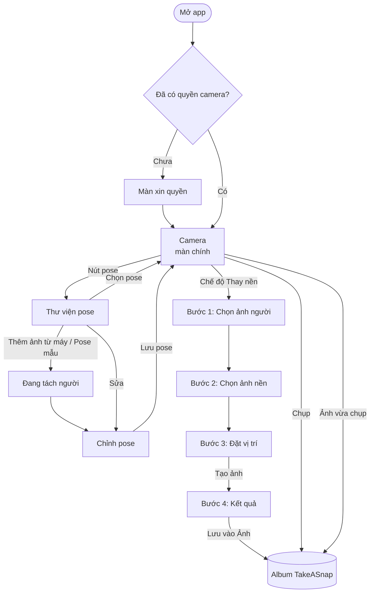
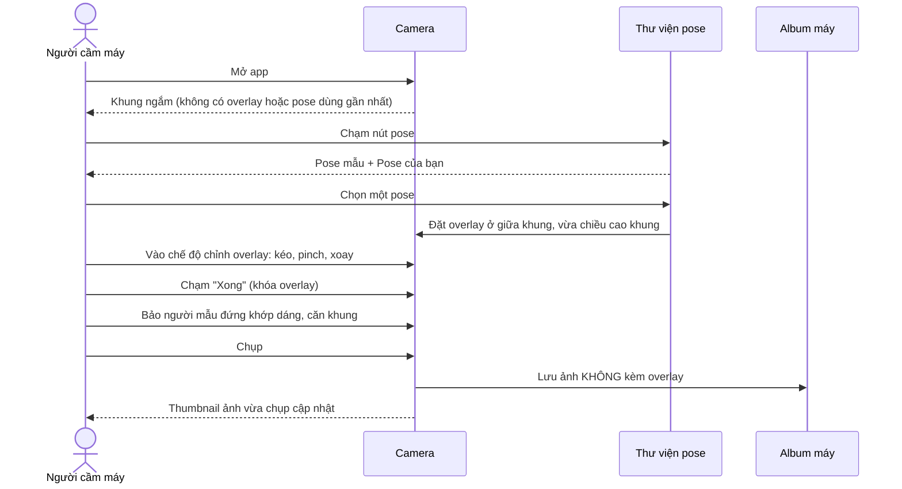
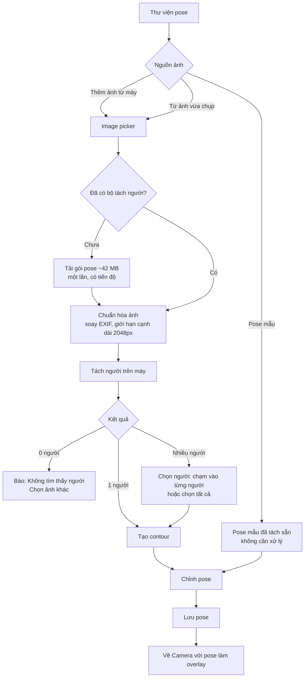
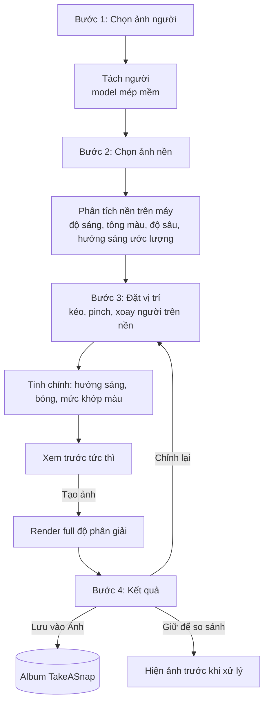
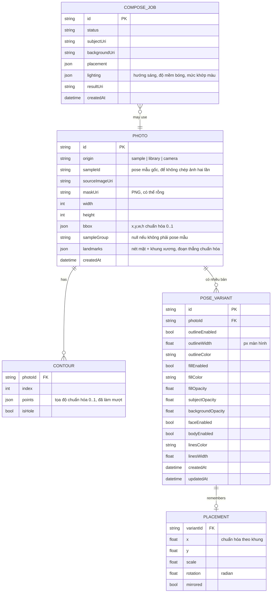
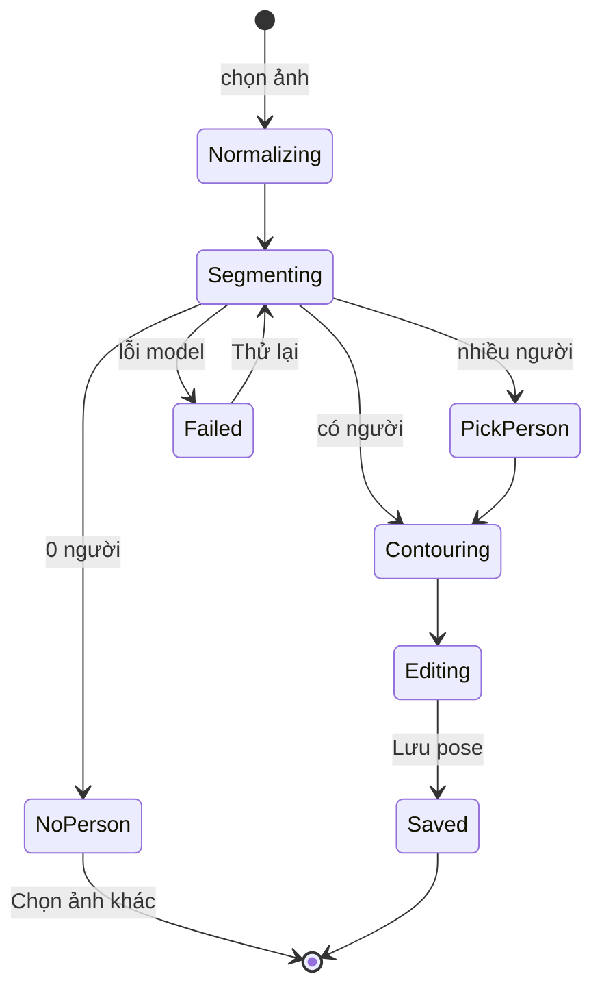
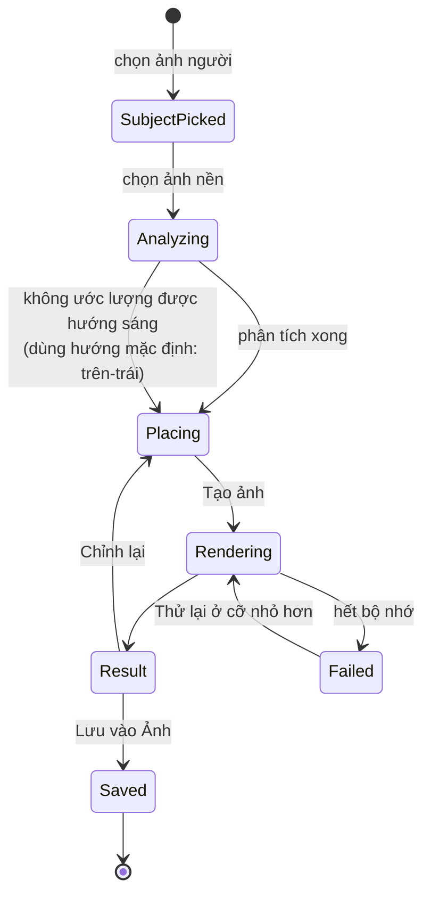

# TakeASnap — Business flow

> Tài liệu nghiệp vụ cho bản rebuild. Mô tả **app làm gì, cho ai, theo luồng nào và theo quy tắc nào**.
> Cách làm kỹ thuật ở [roadmap.md](roadmap.md), giao diện ở [design.md](design.md).

---

## 1. Sản phẩm trong một câu

**TakeASnap là app camera chụp theo dáng mẫu:** tách dáng người từ một ảnh mẫu, đặt dáng đó lên khung ngắm làm lớp hướng dẫn, rồi chụp người thật theo đúng dáng. Ngoài ra app có công cụ ghép người vào nền mới với ánh sáng và bóng đổ khớp cảnh.

Phạm vi v1: **iOS và Android (chạy trong Expo Go), chỉ tiếng Việt, chạy hoàn toàn trên máy, không có server**, là đồ án portfolio.

### Người dùng

| Vai trò | Họ cần gì | Dùng chức năng |
|---|---|---|
| **Người cầm máy** (bạn bè, người yêu, nhiếp ảnh nghiệp dư) | Biết cần bảo người mẫu đứng thế nào, căn khung ra sao | 1 — Chụp theo pose |
| **Người được chụp** | Xem nhanh dáng cần tạo, so với dáng mình đang đứng | 1 — Chụp theo pose |
| **Người sưu tầm dáng** (content creator, người hay chụp ảnh du lịch) | Lưu dáng đẹp thấy trên mạng thành thư viện riêng | 2 — Tạo và chỉnh pose |
| **Người muốn đổi bối cảnh ảnh** | Đưa mình vào một khung cảnh khác mà ảnh không lộ ghép | 3 — Thay nền |

---

## 2. Thuật ngữ (dùng thống nhất trong code, UI và tài liệu)

| Thuật ngữ | Nghĩa | Tên trong code |
|---|---|---|
| **Ảnh nguồn** | Ảnh gốc có người, dùng để tách dáng | `sourceImage` |
| **Mask** | Ảnh alpha 1 kênh: 255 = người, 0 = nền | `mask` |
| **Contour** | Đường bao vector của mask, đã làm mượt | `contours` |
| **Ảnh gốc** | Ảnh có người đã tách: viền + nét mặt + khung xương; dùng chung cho mọi bản pose của nó | `photos` |
| **Pose** (bản pose) | Một ảnh gốc + một bộ style. Một ảnh gốc có thể có nhiều bản | `Pose`, `pose_variants` |
| **Nét mặt / nét tay chân** | Đường vẽ viền mặt, mắt, mũi, môi / khung xương thân, tay, chân | `style.faceEnabled`, `style.bodyEnabled` |
| **Lớp viền** | Nét vẽ theo contour (bật/tắt, độ dày, màu) | `style.outline` |
| **Lớp phủ** | Màu phủ lên vùng mask (bật/tắt, màu, độ đậm) | `style.fill` |
| **Lớp người** | Phần ảnh người thật đã tách (độ hiện) | `style.subject` |
| **Overlay** | Pose đang hiện trên khung ngắm, kèm vị trí/tỉ lệ/góc xoay | `OverlayState` |
| **Ảnh nền** | Ảnh bối cảnh mới ở chức năng 3 | `backgroundImage` |
| **Ảnh ghép** | Kết quả cuối của chức năng 3 | `Composite` |

Trong UI chỉ dùng chữ **"pose"**. Không dùng "segment" hay "form" (bản cũ dùng tên "Danh sách Form").

---

## 3. Bản đồ màn hình

---

## 4. Chức năng 1 — Chụp theo pose

### 4.1 Luồng chính

### 4.2 Hai chế độ thao tác trên khung ngắm

Bản cũ giật vì mọi cử chỉ chồng lên nhau. Bản mới tách hẳn thành **hai chế độ**, mỗi lúc chỉ một chế độ nhận cử chỉ:

| | **Chế độ chụp** (mặc định, overlay đã khóa) | **Chế độ chỉnh overlay** |
|---|---|---|
| Vào bằng | Chạm "Xong", hoặc chạm ra vùng trống | Chạm vào overlay, hoặc nút "Chỉnh pose" |
| 1 ngón kéo | — | Di chuyển overlay |
| 2 ngón pinch | Zoom camera | Phóng/thu overlay quanh tâm hai ngón |
| 2 ngón xoay | — | Xoay overlay (hít về 0° khi lệch dưới 3°, rung nhẹ) |
| Chạm 1 lần | — (camera tự lấy nét; `expo-camera` không có lấy nét theo điểm chạm, để dành cho bản dùng VisionCamera) | — |
| Chạm đúp | — | Đặt lại vị trí/tỉ lệ/góc ban đầu |
| Kéo xuống vùng xóa | — | Gỡ overlay khỏi khung (vùng xóa đổi viền `danger` và rung cảnh báo khi overlay vào) |
| Thanh điều khiển | Hiện đủ | Ẩn hết, chỉ còn "Xong" và vùng xóa |

Pinch và xoay chạy cùng lúc. Kéo, pinch và xoay đều cộng dồn từ trạng thái trước, không bao giờ nhảy về giá trị cũ.

### 4.3 Điều khiển camera

| Điều khiển | Giá trị | Ghi chú |
|---|---|---|
| Đổi camera | sau / trước | Camera trước: preview soi gương, ảnh lưu không soi gương (theo cài đặt) |
| Flash | tắt / bật / tự động | Dùng flash gốc của camera, không dùng đèn pin |
| Lưới | tắt / 3×3 / 4×4 | Vẽ trong vùng ảnh thật sẽ được lưu |
| Thước cân bằng | bật / tắt | Đổi sang màu nhấn khi máy lệch dưới 1° |
| Tỉ lệ khung | 3:4 / 9:16 / 1:1 | Khung ngắm hiển thị đúng vùng ảnh sẽ được lưu |
| Hẹn giờ | tắt / 3 s / 10 s | Cho người chụp tự đặt máy |
| Zoom | chip 0.5× / 1× / 2× + pinch | 0.5× chỉ có trên iPhone có ống góc rộng (đổi ống kính qua `selectedLens`); Android có 1× / 2× |

### 4.4 Điều khiển nhanh cho overlay (khi đang có pose)

- **Độ hiện overlay**: 3 mức chạm nhanh 100% / 60% / 30%.
- **Lật ngang**: soi gương dáng (dáng tay trái thành tay phải).
- **Ẩn tạm**: giữ nút để ẩn overlay, thả ra để hiện lại, dùng khi cần nhìn rõ người thật.
- **Gỡ pose**: xóa overlay khỏi khung. Pose vẫn còn trong thư viện.

---

## 5. Chức năng 2 — Tạo và chỉnh pose

### 5.1 Luồng chính

### 5.2 Màn Chỉnh pose — các lớp và điều khiển

Chỉnh trên **nền ô caro** (vùng trống). Thứ tự lớp từ dưới lên: **nền → người → phủ → ống tay chân → nét mặt → viền**.

| Tab | Lớp | Điều khiển | Khoảng giá trị | Mặc định |
|---|---|---|---|---|
| **Viền** | Viền, Mặt, Tay chân | 3 chip bật/tắt độc lập **[Viền] [Mặt] [Tay chân]** | on/off | on / on / on |
| | (chung) | Độ dày, dùng chung cho cả 3 (nét mặt vẽ mảnh hơn: 0.6 × độ dày) | 1–12 px (theo pixel màn hình, giữ nguyên khi zoom overlay) | 3 px |
| | (chung) | Màu, dùng chung cho cả 3 | 8 màu có sẵn | Trắng |
| **Phủ** | Phủ | Bật/tắt | on/off | on |
| | | Màu | 8 màu có sẵn | Cam |
| | | Độ đậm | 0–100% | 40% |
| **Ảnh** | Người | Độ hiện của người trong ảnh gốc | 0–100% | 0% |
| | Nền | Độ hiện của nền trong ảnh gốc (phần ngoài người) | 0–100% | 0% |
| **Sửa nét** (Phase 3) | Mask | Cọ thêm / cọ xóa vùng mask, hoàn tác 30 bước | cỡ cọ 8–64 px | — |

- **Nét mặt cho biết hướng mặt:** có nét mặt (viền mặt, mắt, lông mày, mũi, môi) nghĩa là người mẫu quay mặt về ống kính; không có nghĩa là quay lưng. Khi không thấy mặt, dòng ghi chú dưới hàng chip ghi rõ. Giới hạn của model: mặt nghiêng hẳn, cúi xuống hoặc bị tay che có thể không được nhận ra.
- **Ống tay, ống chân:** mỗi tay/chân có **hai nét dọc hai bên**, giống viền, để thấy được tay chân đặt ở đâu **cả khi chúng nằm trên thân** (ví dụ tay chống cằm, tay ôm gối, tay cầm sách). Chỗ tay chân đã thò ra ngoài thân thì viền ngoài đã đủ, nên không vẽ thêm. Đầu bàn tay/bàn chân nằm trên thân được khép tròn.
- Cách dựng ống tay chân (src/engine/limbs.ts): lấy khớp vai–khuỷu–cổ tay–bàn tay, hông–gối–cổ chân–mũi chân từ MediaPipe PoseLandmarker; dọc mỗi xương bắn tia vuông góc sang hai bên trong mask. Tia gặp mép bóng người gần thì phía đó đã có viền; tia đi sâu vào thân thì vẽ nét ở bề rộng đo được phía bên kia, hoặc theo tỉ lệ cơ thể, rồi kéo nhẹ về mép thật trong ảnh. **Đây là ước lượng:** tay áo rộng hay tay bị đồ vật che thì nét cho biết vị trí tay chân, không vẽ đúng từng mép vải.
- Nét mặt lấy từ MediaPipe FaceLandmarker. Ảnh toàn thân có mặt nhỏ thì app dò lại trên vùng đầu đã phóng to.
- Mọi thay đổi hiện ngay khi kéo slider, không có nút "Áp dụng". Khi sửa nét bằng cọ, viền được tính lại lúc nhấc ngón tay.
- **Lưu:** "Lưu pose" ghi đè bản đang sửa; "Lưu thành bản mới" thêm một bản khác cho **cùng ảnh gốc**. Với pose mẫu chỉ có "Lưu pose", và nút này luôn thêm bản vào "Pose của bạn" (BR-09).

### 5.3 Thư viện pose

- **Ô pose luôn hiện ảnh gốc đầy đủ màu (người + nền)**: người dùng chọn pose nhờ nhìn cả người mẫu lẫn bối cảnh, để so với bối cảnh mình đang có.
- **Pose mẫu**: đi kèm app, chia nhóm (Quán cà phê, Trường học, Đường phố, Du lịch). Ô là ảnh gốc + viền trắng mảnh. Viền, nét mặt và tay chân đã tách sẵn nên chọn là dùng ngay.
- **Pose của bạn**: lưới phẳng, **mỗi bản pose một ô**, sửa gần nhất trước. Ô là ảnh gốc + style của chính bản đó (phủ, viền, nét), nên các bản từ cùng một ảnh vẫn phân biệt được. Chạm để sửa; nhấn giữ để xóa.
- **Một ảnh gốc, nhiều bản pose:** các bản dùng chung ảnh gốc, viền và nét; chỉ style khác nhau. Lưu nhiều lần từ cùng một pose mẫu cũng không chép lại ảnh.
- Xóa bản cuối cùng của một ảnh thì xóa luôn ảnh gốc và mọi file của nó (ảnh nguồn, mask).

---

## 6. Chức năng 3 — Thay nền

### 6.1 Mục tiêu chất lượng

Ảnh ghép đạt yêu cầu khi người xem **không chỉ ra được ngay đâu là ảnh ghép**. Có 6 tiêu chí, dùng để chấm điểm (xem [roadmap.md](roadmap.md), Phase 4):

1. **Viền**: tóc và mép áo mềm, không còn viền màu của nền cũ.
2. **Tỉ lệ và phối cảnh**: người to nhỏ đúng với vị trí đứng trong cảnh, chân chạm mặt đất.
3. **Hướng sáng**: phía sáng/tối trên người cùng phía với nguồn sáng của nền.
4. **Màu và nhiệt độ màu**: tông da và áo ăn theo không khí màu của nền.
5. **Bóng**: có bóng tiếp xúc dưới chân, và bóng đổ theo hướng sáng khi nền có nắng gắt.
6. **Độ nét, nhiễu, độ mờ hậu cảnh**: người không nét hơn hoặc sạch nhiễu hơn hẳn so với nền.

### 6.2 Luồng chính

### 6.3 Giới hạn của bản v1

- Toàn bộ xử lý trên điện thoại, không gửi ảnh đi đâu. Mục tiêu xuất ảnh dưới 5 s.
- Không có relight bằng model AI (cần GPU). App dùng **relight giả lập**: tô sáng/tối theo hướng sáng và thêm viền sáng ở phía nguồn sáng.
- Kết quả tốt nhất với nền có **ánh sáng mềm** (trong nhà, ngoài trời râm). Nền nắng gắt và cảnh đêm khó khớp hơn.
- Chức năng này có **cổng quyết định** ở [roadmap Phase 4](roadmap.md#phase-4--thay-nền-timebox-3-tuần-có-cổng-quyết-định): có thể bị thu hẹp chỉ còn nền ánh sáng mềm, hoặc bị bỏ khỏi v1.

---

## 7. Luồng phụ

### 7.1 Quyền truy cập

| Quyền | Xin khi nào | Nếu bị từ chối |
|---|---|---|
| Camera | Lần đầu mở app | Màn giải thích + nút "Mở Cài đặt" (`Linking.openSettings()`). App vẫn vào được Thư viện pose và Thay nền |
| Ảnh (đọc) | Lần đầu chọn ảnh từ máy | Dùng image picker của hệ thống. Không cần quyền đọc toàn bộ thư viện |
| Ảnh (ghi) | Lần đầu lưu ảnh | Báo không lưu được, giữ ảnh tạm, cho thử lại |

Không xin quyền nào trước khi người dùng cần đến nó.

### 7.2 Lần đầu mở app

1. Xin quyền camera, một màn, một câu giải thích.
2. Vào thẳng Camera. Không có onboarding nhiều trang.
3. Nút pose nhấp nháy một lần duy nhất để chỉ chỗ chọn pose. Gợi ý: "Chọn một pose để chụp theo".

---

## 8. Quy tắc nghiệp vụ

| Mã | Quy tắc |
|---|---|
| BR-01 | Ảnh chụp ở chức năng 1 **không bao giờ** kèm overlay. Overlay chỉ để hướng dẫn |
| BR-02 | Ảnh lưu vào album "TakeASnap" đúng tỉ lệ khung đang chọn. Vùng ảnh lưu trùng đúng vùng thấy trên khung ngắm |
| BR-03 | Mọi xử lý ảnh (tách người, phân tích nền, ghép ảnh) chạy **hoàn toàn trên máy**. Ảnh không bao giờ được gửi đi. Kết nối mạng duy nhất là tải bộ tách người (BR-13) |
| BR-13 | Bộ tách người được tải **một lần** khi dùng chức năng lần đầu: gói pose (~42 MB) khi tạo pose từ ảnh lần đầu; gói Thay nền (~111 MB nếu máy có WebGPU, ~56 MB nếu không) khi Thay nền lần đầu. Tải xong thì lưu vĩnh viễn và chạy offline. Pose mẫu đã tách sẵn nên không cần tải |
| BR-04 | Ảnh ghép xuất ra đúng độ phân giải gốc của ảnh nền. Người trong ảnh không bị phóng quá 1.5× độ phân giải gốc của ảnh người (vượt quá thì báo "Ảnh người sẽ bị vỡ nét ở cỡ này") |
| BR-05 | Trong Thay nền, chân người phải nằm trong ảnh nền. Kéo chân ra ngoài mép dưới thì bóng không được vẽ, và app hiện gợi ý "Kéo người lên để thấy bóng" |
| BR-06 | Một pose phải có ít nhất một vùng người chiếm từ 2% diện tích ảnh trở lên. Nhỏ hơn thì báo "Người trong ảnh quá nhỏ" |
| BR-07 | Ảnh nguồn được chuẩn hóa: xoay theo EXIF, cạnh dài tối đa 2048 px cho pose, giữ nguyên độ phân giải gốc cho chức năng 3 |
| BR-08 | Mọi file của pose nằm trong `documentDirectory`, không bao giờ nằm trong cache |
| BR-09 | Pose mẫu chỉ đọc. Sửa pose mẫu là tạo bản sao |
| BR-10 | Overlay nhớ vị trí/tỉ lệ/góc lần dùng gần nhất của từng pose |
| BR-11 | Khi ở chế độ chỉnh overlay, camera không nhận pinch-zoom |
| BR-12 | Lưu ảnh lỗi thì không mất ảnh: giữ bản tạm và cho thử lại |

---

## 9. Mô hình dữ liệu

Khác với bản cũ:
- Một ảnh gốc có nhiều bản pose (bản cũ: mỗi lần lưu là một bản sao đầy đủ).
- Độ hiện nền vẫn có, nhưng tách nền bằng viền (cắt ngược) thay cho file `bg.png` riêng như bản cũ.
- Bỏ file `outline.png`. Viền được vẽ từ contour vector nên đổi độ dày được.
- Kiểu `SegmentData` không còn bị khai báo lặp ở 3 file.

---

## 10. Trạng thái và lỗi

### 10.1 Tách người (chức năng 2)

### 10.2 Ghép ảnh (chức năng 3)

### 10.3 Thông báo lỗi

Mỗi thông báo nói **chuyện gì xảy ra** và **làm gì tiếp**, không đổ lỗi cho người dùng, không dùng dấu chấm than.

| Tình huống | Thông báo | Hành động |
|---|---|---|
| Không có người | Không tìm thấy người trong ảnh. Chọn ảnh có người nhìn rõ. | Chọn ảnh khác |
| Người quá nhỏ | Người trong ảnh quá nhỏ để lấy dáng. Chọn ảnh chụp gần hơn. | Chọn ảnh khác |
| Lưu ảnh lỗi | Chưa lưu được ảnh vào máy. Ảnh vẫn được giữ tạm. | Thử lưu lại |
| Tải bộ tách người lỗi | Chưa tải được bộ tách người. Kiểm tra kết nối mạng rồi thử lại. | Thử tải lại |
| Không đoán được hướng sáng | Chưa xác định được hướng sáng của nền. Xoay vòng Hướng sáng để chọn. | (vòng xoay được làm nổi) |
| Ghép ảnh hết bộ nhớ | Ảnh nền quá lớn để ghép. Thử lại ở 12 MP. | Thử lại ở 12 MP |
| Thiếu quyền camera | TakeASnap cần camera để chụp theo pose. | Mở Cài đặt |

---

## 11. Online / offline

App chỉ dùng mạng để **tải bộ tách người một lần** (BR-13). Sau đó mọi chức năng chạy được ở chế độ máy bay.

| Chức năng | Chạy bằng |
|---|---|
| Camera, chụp, lưu | `expo-camera`, `expo-media-library` |
| Tách người, chỉnh pose, thư viện | Model trong WebView ẩn (tải một lần lần đầu), Skia, SQLite |
| Pose mẫu | Đóng gói sẵn trong app (mask + contour tính trước) |
| Thay nền | Model trong WebView ẩn (tải một lần lần đầu), Skia |
