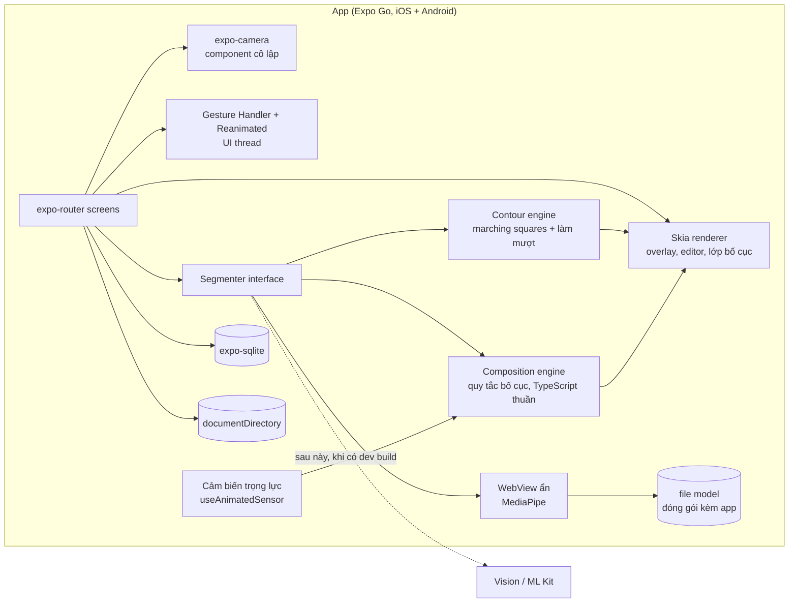

# SnapShot — Roadmap rebuild

> Kế hoạch làm lại toàn bộ dự án: rút kinh nghiệm từ bản cũ, chốt kiến trúc mới và chia việc theo phase. Mỗi phase có tiêu chí hoàn thành đo được.
> Nghiệp vụ ở [business-flow.md](business-flow.md), giao diện ở [design.md](design.md).

---

## 0. Phạm vi đã chốt

| Câu hỏi | Quyết định | Hệ quả |
|---|---|---|
| Nền tảng | **iOS và Android, một codebase.** Test chính trên iPhone của bạn | Mọi thư viện phải chạy được trên cả hai nền tảng |
| Môi trường | **Windows + VS Code + Expo Go** | **Không có code native tự viết** (Swift/Kotlin), không cần Mac, không cần build |
| Mục đích | **Đồ án portfolio**, không phát hành store | Không cần Sentry, chính sách quyền riêng tư hay ảnh store. Thay vào đó cần video demo và bài viết case study |
| Ngân sách GPU | **Không có** | **Bỏ hẳn server.** App chạy 100% trên máy, kể cả phân tích bố cục; không dùng AI trên cloud |
| Ngôn ngữ | **Chỉ tiếng Việt** | Không cài thư viện i18n; mọi chuỗi nằm trong `src/ui/strings.ts` |
| Ảnh pose mẫu | Dùng được (phi thương mại) | Model có license phi thương mại cũng dùng được, vẫn ghi nguồn |

### Vì sao Expo Go đủ

App vẫn là app native: React Native vẽ giao diện bằng view native của iOS và Android. Expo Go chỉ giới hạn ở chỗ **không nạp được code native tự viết**. Trong khi đó, các thư viện nặng mà dự án cần đều đã có sẵn trong Expo Go: Skia, Reanimated, Gesture Handler, Camera, SQLite, WebView, Sensors, Haptics.

Phần duy nhất cần native là **tách người**. Phần này chạy bằng một model segmentation trong **WebView ẩn** (WASM / WebGL). File model đóng gói kèm app nên vẫn chạy offline, và cùng một code chạy trên cả iOS lẫn Android.

### Đường nâng cấp sau này

Phần tách người đi qua interface `Segmenter` (§3.3). Khi có điều kiện dùng dev build, chỉ cần thay phần cài đặt bên dưới, phần còn lại giữ nguyên:
- **Android:** build được ngay trên Windows bằng Android Studio (`npx expo run:android`), dùng ML Kit.
- **iOS:** cần Mac, hoặc GitHub Actions macOS + Sideloadly, dùng Apple Vision.

---

## 1. Tóm tắt quyết định kỹ thuật

| Vấn đề cũ | Quyết định mới |
|---|---|
| Tách người phải gọi server qua LAN IP | **Tách người trên máy bằng model trong WebView ẩn** (MediaPipe). Không còn server |
| Code backend bị mất | Không cần backend nữa. Mọi thứ nằm trong một repo |
| Không có hướng dẫn bố cục khi chụp | **Trợ lý bố cục**: model trên máy tìm người, mắt, khớp; cảm biến đo góc máy; quy tắc của nghề ảnh viết bằng TypeScript ra gợi ý giải thích được (§3.6). Có **cổng quyết định** cho gợi ý lúc ngắm (Phase 5) |
| Cử chỉ chồng chéo, giật | `react-native-gesture-handler` Gesture API + `react-native-reanimated` shared value, chạy trên UI thread. **Không có setState nào trong lúc cử chỉ đang diễn ra** (riêng zoom camera, xem §3.5) |
| Viền không đổi được độ dày | Viền vẽ từ **contour vector** bằng Skia, đổi độ dày và màu realtime |
| Flash auto giả, crop sai | `expo-camera` dùng `flash="auto"` gốc; crop theo kích thước ảnh thật, không theo % màn hình |
| Điều hướng bằng `useState` trong `App.tsx` | **`expo-router`** |
| Lưu metadata bằng file JSON | **`expo-sqlite`**. File ảnh nằm trong `documentDirectory` |
| Ionicons + emoji | **Lucide** (`lucide-react-native`, chạy trên `react-native-svg`) |

---

## 2. Bài học từ bản cũ

Các lỗi đã đọc thấy trong code. Đây là danh sách phải tránh lặp lại, không phải danh sách cần sửa (bản cũ sẽ bị thay thế).

### 2.1 Camera — [CameraScreen.tsx](../src/screens/CameraScreen.tsx)

| # | Lỗi | Hậu quả |
|---|---|---|
| L1 | `PanResponder` tạo một lần trong `useRef`, đọc state `currentRotate` của lần render đầu (stale closure, luôn = 0) | Mỗi lần pinch, góc xoay nhảy về 0 |
| L2 | `scale.setValue(distance / initialPinchDistance)`, không nhân với scale trước đó | Mỗi lần pinch mới, overlay nhảy về cỡ gốc |
| L3 | `position.setValue({ x: dx, y: dy })`, không cộng offset cũ | Mỗi lần kéo, overlay nhảy về giữa |
| L4 | Kéo, pinch và xoay tự tính bằng tay trong một responder; zoom camera dùng `FlatList` riêng | Cử chỉ giành nhau, overlay giật |
| L5 | Zoom và accelerometer gọi `setState` liên tục (mỗi frame / mỗi 100 ms) ở component cha | Re-render cả màn, kể cả `CameraView` và overlay |
| L6 | Flash auto chụp một ảnh mỗi giây, độ sáng lấy từ `Math.random()`, bật/tắt **đèn pin** | Đèn nháy ngẫu nhiên, tốn pin |
| L7 | Crop cố định 15%–75% chiều cao preview, không tính tỉ lệ cảm biến và `cover` scaling | Ảnh lưu lệch so với khung đã thấy |

### 2.2 Pose — [SegmentUtils.ts](../src/components/SegmentUtils.ts), [SegmentStorage.ts](../src/components/SegmentStorage.ts), [SegmentEditor.tsx](../src/screens/SegmentEditor.tsx)

| # | Lỗi | Hậu quả |
|---|---|---|
| L8 | LAN IP `192.168.1.6` viết cứng | Chỉ chạy được trong mạng nhà |
| L9 | Ảnh lưu trong `cacheDirectory`, metadata trong `documentDirectory` | Hệ điều hành dọn cache thì pose mất ảnh, thư viện vỡ |
| L10 | `deleteSegment` không xóa file `outline` | Rò file |
| L11 | Viền là PNG từ server, chỉ `tintColor` được | Không đổi được độ dày |
| L12 | Kiểu `SegmentData` khai báo lặp ở 3 nơi | Lệch kiểu khi sửa |
| L13 | Pose mẫu phải gửi lên server tách lại mỗi lần chọn | Chậm, cần mạng cho cả ảnh mẫu |

### 2.3 Giao diện

- Màu nhấn tím `#C259FF` và bảng màu phủ có tím (`#a5b4fc`, `#c4b5fd`). Design mới cấm tím, xem [design.md](design.md).
- Dùng emoji làm icon (📸 ✏️ 🗑️), trộn với Ionicons.
- Mỗi màn một kiểu nút và một màu xanh khác nhau (`#3b82f6`, `#0a84ff`, `#007bff`, `#2196f3`).
- Copy trộn Việt/Anh, có câu quảng cáo ("Ảnh đẹp lung linh"), nút chung chung ("Xác nhận").

---

## 3. Kiến trúc mới

### 3.1 Sơ đồ tổng

Toàn bộ chạy trên điện thoại, không có thành phần mạng.



### 3.2 Stack

Mọi thư viện dưới đây đều có sẵn trong Expo Go hoặc là JS thuần.

| Lớp | Chọn | Ghi chú |
|---|---|---|
| Runtime | Expo SDK **đúng bản mà Expo Go trên App Store đang hỗ trợ** | Expo Go chỉ chạy SDK mới nhất. Khi Expo Go cập nhật thì nâng SDK theo |
| Điều hướng | `expo-router` | |
| Camera | `expo-camera` | `flash="auto"` gốc, `mirror`, `selectedLens` (chọn ống góc rộng trên iOS) |
| Cử chỉ | `react-native-gesture-handler` v2 (Gesture API) | `Gesture.Simultaneous`, `Gesture.Exclusive`, bật/tắt theo chế độ |
| Animation | `react-native-reanimated` | Shared value, worklet |
| Vẽ | `@shopify/react-native-skia` (đã có trong `package.json`, bản cũ chưa dùng) | Overlay 3 lớp, editor, lớp bố cục |
| Tách người | `react-native-webview` + model chạy trong WebView | Ứng viên ở §3.3 |
| Cảm biến | `useAnimatedSensor` của Reanimated (trọng lực) | Ghi vào shared value, không setState; dùng cho thước cân bằng và gợi ý góc máy |
| State | `zustand` cho state phiên, SQLite cho dữ liệu lưu | |
| Lưu trữ | `expo-sqlite`, `expo-file-system`, `expo-media-library`, `expo-image-manipulator` | |
| Sheet | `presentation: 'formSheet'` của expo-router; dự phòng `@gorhom/bottom-sheet` | Kiểm tra trên Android ở Phase 0 |
| Font | `@expo-google-fonts/nunito` (Phase 4, thay Urbanist + DM Mono) | Theo design.md §3.3 |
| Icon | `lucide-react-native` | Một bộ chung cho cả hai nền tảng |
| Haptics | `expo-haptics` qua `src/lib/haptics.ts` | Có trong Expo Go trên iOS (spike D); Android chưa đo |
| Chuỗi giao diện | `src/ui/strings.ts` | Chỉ tiếng Việt |
| Chất lượng | TypeScript strict, ESLint, Prettier, Jest cho logic thuần | |

### 3.3 Tách người — `Segmenter`

```ts
// src/engine/segmentation/types.ts
export type SegmentResult = {
  width: number;
  height: number;
  maskUri: string;   // PNG 1 kênh, alpha mềm, cùng kích thước ảnh đã chuẩn hóa
  regions: { bbox: [number, number, number, number]; areaRatio: number }[]; // các vùng người tách rời
};

export interface Segmenter {
  ready(): Promise<void>;                       // nạp model một lần
  segment(imageUri: string): Promise<SegmentResult>;
}

// Bản v1:      WebViewSegmenter   (Expo Go, iOS + Android)
// Sau này:     NativeSegmenter    (dev build: Vision trên iOS, ML Kit trên Android)
```

Cách `WebViewSegmenter` chạy:

1. Một `<WebView>` 1×1 px, ẩn, được mount một lần ở `app/_layout.tsx`. Trang HTML, thư viện JS, file `.wasm` và file model đều là asset trong app.
2. JS gửi ảnh đã hạ xuống **cạnh dài 1024 px** (base64) qua `postMessage`.
3. Trong WebView: chạy model → mask → làm mềm mép → encode PNG → trả base64 về.
4. JS ghi PNG vào `documentDirectory`, tìm các vùng người tách rời (connected components trên mask 256 px), rồi trả `SegmentResult`.

**Đã chốt sau spike B trên iPhone 15 Pro Max** (chi tiết ở [spikes.md](spikes.md#chốt-spike-b-iphone)):

| Dùng cho | Model | Thư viện | Đo trên iPhone |
|---|---|---|---|
| **Pose** và **bố cục** | MediaPipe `selfie_multiclass_256x256` + FaceLandmarker + PoseLandmarker | `@mediapipe/tasks-vision` 1.1.1, GPU | ~105 ms cả vòng (tách người) |

- Multiclass: lấy `1 − kênh nền` rồi kéo dãn [0.25, 0.65] → [0, 1] (kênh nền chỉ đạt 0.8–0.96 trên vùng nền).
- Đã loại: MediaPipe Selfie (cắt mất chân, váy), DeepLab v3 (mép nhòe, dính nền), U²-Net human seg (176 MB).
- Đã thử và bỏ: guided filter làm mịn mép (quầng sáng, lem nền).
**Cách đưa model vào app: đã chốt phương án C, tải khi dùng lần đầu và lưu vĩnh viễn trong máy.**

| Gói | Gồm | Dung lượng | Tải khi |
|---|---|---|---|
| `pose` | Multiclass 15.6 MB + FaceLandmarker 3.6 MB + PoseLandmarker full 9.0 MB + MediaPipe wasm 12.9 MB + JS | ~42 MB | Tạo pose lần đầu, hoặc gợi ý bố cục cần phân tích người lần đầu (pose mẫu đã tách sẵn, không cần gói này) |
| `composition` (Phase 5b) | Model tự chọn kỹ thuật bố cục (TFLite có metadata, tự huấn luyện) | ~5 MB | Dùng "Tự chọn" lần đầu; chạy bằng MediaPipe wasm của gói `pose` |

- Tải từ **CDN gốc** với phiên bản cố định: jsDelivr (MediaPipe), Google Storage (Multiclass, FaceLandmarker, PoseLandmarker). Chưa làm bản sao trên GitHub Releases; nếu CDN gốc gặp sự cố thì thêm sau, chỉ phải đổi URL.
- Model tự huấn luyện (gói `composition`, Phase 5b) không có CDN gốc: đặt ở **GitHub Releases** của repo, tag cố định (ví dụ `composition-v1`), không commit file model vào repo.
- Lưu trong `Paths.document/models/<gói>/`, kèm `manifest.json` (URL, kích thước, phiên bản). Mở app thấy đủ file đúng kích thước thì không tải lại.
- Đã cân nhắc và bỏ: A. đóng gói tất cả (~196 MB trong app và repo, vướng license); B. đóng gói riêng pose (hai cơ chế, mà trong Expo Go app vẫn tải qua mạng ở lần mở đầu nên lợi thế offline gần như không có); D. tải từ CDN mỗi lần (iOS có thể xóa cache, không offline thật).
- Việc kỹ thuật cần làm ở Phase 1: đưa file từ `Paths.document` vào WebView (đọc file và truyền vào, hoặc cho WebView quyền đọc thư mục model).

Pose mẫu được tách sẵn trên máy tính bằng đúng trang WebView của app chạy trong Chrome headless (`scripts/build-sample-poses.mts`), nên chọn pose mẫu là dùng được ngay.

### 3.4 Contour và 3 lớp

1. Mask → hạ mẫu xuống cạnh dài 512 px → marching squares (`marchingsquares` đã có trong deps) → danh sách contour, có phân biệt lỗ (khe giữa tay và thân).
2. Đơn giản hóa bằng Douglas–Peucker (ε ≈ 0.75 px), rồi làm mượt bằng Catmull–Rom → `SkPath`.
3. Lưu điểm dưới dạng tọa độ chuẩn hóa 0..1, dùng được ở mọi kích thước.
4. Vẽ 3 lớp trong **một `<Canvas>` Skia**:
   - Người: `Image` với `opacity`.
   - Phủ: mask làm alpha, `BlendMode.SrcIn` với màu phủ, `opacity`.
   - Viền: `Path` stroke, `strokeWidth = outlineWidth / overlayScale` để độ dày trên màn hình không đổi khi zoom.
5. Mọi giá trị style là **shared value** truyền thẳng vào Skia. Kéo slider không gây re-render React.

### 3.5 Hệ cử chỉ

Gesture Handler 3.3 (bản đi kèm SDK 58) dùng **API hook**; builder `Gesture.Pan()` đã deprecated. Code thật ở [src/gestures/useTransformGesture.ts](../src/gestures/useTransformGesture.ts), toán tách riêng ở [transformMath.ts](../src/gestures/transformMath.ts) và có unit test.

```ts
// Chế độ chỉnh overlay (editMode = true)
const pan    = usePanGesture({ enabled: editMode, onUpdate: (e) => { 'worklet'; tx.value += e.changeX; ty.value += e.changeY; } });
const pinch  = usePinchGesture({ enabled: editMode, onUpdate: (e) => { 'worklet'; /* scaleAbout(t, focal, e.scaleChange) */ } });
const rotate = useRotationGesture({ enabled: editMode, onUpdate: (e) => { 'worklet'; /* rotateAbout(t, anchor, e.rotationChange) */ } });
const reset  = useTapGesture({ enabled: editMode, numberOfTaps: 2, onActivate: () => { 'worklet'; resetTo(initial); } });
const overlayGesture = useExclusiveGestures(reset, useSimultaneousGestures(pan, pinch, rotate));

// Chế độ chụp (editMode = false)
const camZoom = usePinchGesture({ enabled: !editMode, onUpdate: (e) => { 'worklet'; zoomSV.value = clamp(zoomSV.value + (e.scaleChange - 1) * 0.6); } });
```

Sang JS chỉ bằng `scheduleOnRN` của `react-native-worklets` (thay cho `runOnJS`), và chỉ khi cử chỉ kết thúc.

Quy tắc:
- Mọi phép biến đổi **cộng dồn** bằng `changeX`, `scaleChange`, `rotationChange`. Không tính lại từ điểm đầu.
- Pinch neo theo **tâm hai ngón**: điểm dưới ngón tay đứng yên khi phóng to.
- Cử chỉ chỉnh overlay nhận trên **toàn khung ngắm**, không chỉ trên vùng overlay, nên pose nhỏ vẫn chỉnh được.
- Chỉ gọi `scheduleOnRN` khi cử chỉ **kết thúc** (lưu placement, haptics).
- Hít góc 0°/90° khi lệch dưới 3°. Giới hạn scale 0.2×–4×.
- Hook `useTransformGesture` dùng cho overlay camera; Phase 5 thêm dính vào đường 1/3 / trục giữa của lớp bố cục.

**Ngoại lệ: zoom camera.** `expo-camera` nhận zoom qua prop, nên bắt buộc phải có state. Cách làm:
- `CameraView` nằm trong một component riêng, `React.memo`, chỉ nhận `zoom` và vài prop camera. Overlay, lưới và thanh điều khiển nằm **ngoài** component này.
- Shared value `zoomSV` đẩy sang state bằng `useAnimatedReaction` + `runOnJS`, giới hạn khoảng 30 lần/giây.
- Chỉ component camera re-render; overlay không bị ảnh hưởng.

### 3.6 Trợ lý bố cục — trên máy

Nghiệp vụ ở [business-flow §6](business-flow.md#6-chức-năng-3--trợ-lý-bố-cục), danh mục kỹ thuật ở [composition.md](composition.md).

**Cách nghĩ:** model chỉ dùng để **phát hiện** (người, mắt, khớp); lời khuyên đến từ **quy tắc** viết bằng TypeScript thuần, có unit test. Không dùng model chấm thẩm mỹ (điểm mơ hồ, không giải thích được).

| Lớp | Cách làm |
|---|---|
| 1. Nguồn dữ liệu | Cảm biến trọng lực (nghiêng, ngửa / cúi), zoom và camera trước / sau đang dùng; với ảnh: vùng người (Multiclass), mắt và hướng mặt (FaceLandmarker), 33 khớp (PoseLandmarker) |
| 2. Đặc trưng | `features.ts`: khung người, đỉnh đầu, vị trí mắt, hướng mặt, khớp sát mép, cỡ cảnh, cỡ mặt, độ nghiêng, độ ngửa, đỉnh đầu từng người. Tọa độ chuẩn hóa theo khung ảnh sẽ lưu |
| 3. Quy tắc | Mỗi kỹ thuật một hàm thuần `(features) → { reached, hint, target }`, ngưỡng nằm trong token (dữ liệu thuần, test được) |
| 4. Chọn gợi ý | Thứ tự ưu tiên + chống nhảy: một gợi ý mỗi lúc, chỉ hiện khi ổn định ~0,5 s (BR-05) |
| 5. Vẽ | Lớp bố cục bằng Skia trong vùng ảnh sẽ lưu: đường kẻ, chấm đích, màu nhấn khi đạt |
| 6. Nhận xét sau khi chụp | Chạy bộ tách người trên ảnh vừa chụp (thu nhỏ), áp cùng quy tắc, tính khung cắt gợi ý |

**Gợi ý lúc ngắm (cần đo, Phase 5 tuần 2):** Expo Go không có frame processor, nên lấy ảnh bằng `takePictureAsync({ shutterSound: false })` cỡ nhỏ theo chu kỳ, gửi vào WebView đang có, nhận đặc trưng về. Cần đo: số lần phân tích mỗi giây, độ trễ, có nháy màn / tiếng không, pin và nhiệt máy trên iPhone và Android. Ảnh tạm xóa ngay (BR-14). Gợi ý chỉ cần cảm biến thì chạy tức thì trên UI thread, không phụ thuộc phần này.

### 3.7 Cấu trúc thư mục

```
src/
  app/                        # expo-router (SDK 58 đặt route trong src/app)
    _layout.tsx               # font, cử chỉ, SQLite; sau này mount WebView segmenter
    index.tsx                 # Camera (Phase 0: menu spike)
    library.tsx               # Thư viện pose (formSheet)
    editor/[poseId].tsx       # Chỉnh pose
    review.tsx                # Xem ảnh vừa chụp (+ nhận xét bố cục, Phase 5)
    learn/                    # Thẻ học bố cục (Phase 5; hoặc tab trong library, chốt khi thiết kế)
    settings.tsx
    spike/                    # màn đo của Phase 0; sau Phase 2 chỉ còn spike B (tách người), xóa khi xong Phase 5
  features/
    camera/                   # CameraLayer (memo), controls, overlay, capture
    pose/                     # library, editor, repository
    composition/              # kỹ thuật, đặc trưng, quy tắc, chọn gợi ý (TypeScript thuần + test), lớp bố cục Skia
  engine/
    segmentation/             # types.ts, WebViewSegmenter.tsx, web/ (HTML + JS chạy trong WebView)
    contour.ts                # marching squares, DP, Catmull–Rom (có unit test)
    image.ts                  # chuẩn hóa EXIF, resize
  gestures/useTransformGesture.ts
  lib/haptics.ts              # rung, tự tắt nếu Expo Go thiếu module
  ui/
    tokens.ts                 # màu, chữ, khoảng cách, radius, motion (dữ liệu thuần)
    easing.ts                 # hàm easing dựng từ token
    strings.ts                # mọi chuỗi tiếng Việt
    components/               # Button, IconButton, Slider, Segmented, Swatch, Screen...
  db/                         # schema + migration SQLite
  store/                      # zustand
assets/
  models/                     # không có: model tải về Paths.document/models khi dùng lần đầu (§3.3)
  poses/
    source/                   # 32 ảnh mẫu gốc: 25 ảnh chuyển từ bản cũ + 7 ảnh selfie (Phase 4)
scripts/build-sample-poses.ts # thay cho src/components/samplesGenerate.js
docs/
```

---

## 4. Các phase

Ước lượng cho **1 người làm, full-time**. Mỗi phase kết thúc bằng một bản chạy được trong Expo Go trên iPhone, và đã kiểm tra trên Android.

### Phase 0 — Nền móng và spike (1–2 tuần)

- [x] Môi trường Windows: nvm-windows + Node 24.22.2 (SDK 58 cần Node ≥ 22.13), VS Code, Git
- [x] Expo Go trên iPhone 15 Pro Max (iOS 26) và emulator Pixel 8a (Android Studio)
- [x] Tag bản cũ `legacy-v0`, làm rebuild trên nhánh `rebuild`
- [x] **Push lên GitHub** (tag `legacy-v0` + nhánh `rebuild`)
- [x] Khởi tạo project mới: Expo SDK 58, RN 0.88, TypeScript strict, ESLint, Prettier, Jest, `expo-router`
- [x] **Spike A — camera:** `CameraLayer` cô lập + pinch zoom qua shared value *(iOS: UI 60 / JS 55–58. Android emulator: UI 58–60 / JS ~35 sau khi giới hạn zoom 30 lần/giây)*
- [x] **Spike B — tách người:** các model MediaPipe trong WebView *(chốt ở §3.3: Multiclass cho pose. Android emulator: GPU đọc mask ra 0 → tự lùi CPU)*
- [x] **Spike C — Skia overlay:** viền + phủ + ảnh trên 1 canvas, slider độ dày ở 60 fps *(iOS và Android emulator: UI ≥ 58)*
- [x] **Spike D — giới hạn Expo Go:** album, haptics, `formSheet` *(iOS 5/5. Android: haptics có, sheet tốt; lưu album lỗi quyền AUDIO → đã sửa, chờ đo lại)*
- [x] `src/ui/tokens.ts`, `src/ui/strings.ts` và component nền: Button, IconButton, Slider, Segmented, Swatch, Screen (sheet dùng `formSheet` của expo-router)
- [x] `useTransformGesture` + toán biến đổi có unit test (dùng lại ở Phase 2 và Phase 5)
- [x] Schema SQLite v1 + migration
- [x] CI: typecheck + lint + unit test (GitHub Actions)

**Xong khi:** 4 spike có số đo ghi vào `docs/spikes.md`; đã chọn model cho pose.

**Trạng thái:** đạt. Còn một việc nhỏ không chặn Phase 1: đo lại lưu album trên Android sau khi sửa quyền.

### Phase 1 — Pose engine và Chỉnh pose (2–3 tuần)

- [x] Bộ tải model (phương án C, §3.3): `src/engine/models/` tải gói `pose` (6 file, 43.5 MB) từ CDN gốc vào `Paths.document/models/pose/`, có tiến độ, tải vào `.part` rồi mới đổi tên, kiểm tra đúng dung lượng, manifest theo phiên bản. WebView chế độ `local`: app gửi file theo khúc base64 1 MB, trang ghép thành `blob:` URL / `modelAssetBuffer` (WKWebView chặn fetch `file://`). Kiểm trên Chrome **đã tắt mạng**: gửi gói ~3 s, 0 yêu cầu tới CDN
- [x] `SegmenterProvider` (gắn một lần ở `_layout`): tải gói nếu thiếu, gửi gói vào trang một lần mỗi phiên (gửi lại nếu trang bị nạp lại), ảnh 1024 px → mask PNG + lưới alpha 512 + nét mặt. "Thêm ảnh từ máy" trong Thư viện: viền, kiểm BR-06, lưu `source.jpg` + `mask.png`, mở Chỉnh pose; dòng trạng thái thay nút khi đang xử lý. Chọn từng người khi ảnh có nhiều người: Phase 3
- [x] `engine/contour.ts` có unit test (hình vuông, vành khuyên có lỗ, nhiều vùng, chạm mép, ô chéo, mảng li ti, đơn giản hóa, SVG). Tự viết marching squares vì thư viện `marchingsquares` là AGPL-3.0
- [x] Màn Chỉnh pose: 3 lớp, mọi điều khiển ở [business-flow §5.2](business-flow.md#52-màn-chỉnh-pose--3-lớp-và-các-điều-khiển), trừ Sửa nét
- [x] Repository pose: tạo, sửa, xóa (xóa sạch file); bản sao từ pose mẫu (BR-09); migration v2 cho `mask_uri` rỗng
- [x] `scripts/build-sample-poses.mts`: tách sẵn 25 ảnh bằng đúng trang WebView + engine viền, ghi `assets/poses/samples.json` (47 KB, chỉ viền vector). Lớp "Người" cắt ảnh theo viền nên pose mẫu không cần mask
- [x] Thư viện pose (Phase 1: Pose mẫu + Pose của bạn, nhấn giữ để xóa) để vào được Chỉnh pose
- [x] **Góp ý sau lần thử đầu:** ô thư viện hiện ảnh gốc đầy đủ màu; Chỉnh pose trên nền ô caro; nét mặt (FaceLandmarker, dò lại trên vùng đầu phóng to khi mặt nhỏ) và nét tay chân (PoseLandmarker full); độ hiện nền; 1 ảnh gốc → nhiều bản pose ("Lưu thành bản mới"), migration v3
- [x] **Góp ý lần 2:** nét mặt gộp vào tab Viền (cùng màu, độ dày); nét tay chân đổi từ khung xương sang **ống tay, ống chân** hai nét (src/engine/limbs.ts, có test): chỉ vẽ ở chỗ tay chân nằm trên thân, kéo về mép thật trong ảnh; bản sao từ pose mẫu luôn lấy dữ liệu mới nhất
- [x] **Góp ý lần 3:** bỏ hẳn ống tay chân (module, test, dữ liệu); Viền và Mặt chung tab nhưng màu, độ dày riêng (dùng lại cột lines_color / lines_width, không cần migration); "Pose của bạn" 4 ảnh một hàng
- [x] **Góp ý lần 4–5:** nét mặt 0.5–5 px. Ảnh trong Chỉnh pose hiện đầy đủ (contain), caro chỉ trong khung ảnh (đã thử cover + kéo/pinch ở lần 4 và bỏ). Ô thư viện kiểu cover

**Xong khi:** chọn ảnh → có pose trong dưới 4 s trên iPhone (mục tiêu, sẽ chỉnh theo spike B); mọi slider đổi hình ngay trong frame kế tiếp; độ dày viền đổi được từ 1 đến 12 px.

**Trạng thái:** đạt (xác nhận trên iPhone 15 Pro Max): Thư viện, Chỉnh pose, tạo pose từ ảnh trong máy. Chưa ghi số đo thời gian và chưa xác nhận riêng chế độ máy bay.

### Phase 2 — Camera và overlay (2–3 tuần)

**Trạng thái: xong.** Đạt cả ma trận cử chỉ trên iPhone 15 Pro Max và Android emulator Pixel_8a sau hai lần thử, kết quả ở [phase2-test.md](phase2-test.md). Emulator không thử được crop ảnh và thước cân bằng (đã đạt trên iPhone). Để lại: số zoom hiển thị vẫn là ước lượng (`cameraZoom.iosMaxFactor`, `cameraZoom.androidMaxRatio`); qua mốc 1× trên iPhone còn chớp vì đổi ống vật lý (Phase 4: đã chuyển sang camera ảo Triple / Dual Wide, máy tự chuyển ống nên hết chớp; máy chỉ có ống rời vẫn còn).

**Góp ý lần 1 (iPhone):** flash "bật" không nháy → dùng đèn trong lúc chụp; thư viện formSheet vỡ bố cục → modal; bỏ chế độ chỉnh riêng: chạm vào pose là kéo ngay, vùng nhận cử chỉ cả màn hình; vùng xóa ăn theo ngón tay, có hiệu ứng mờ và thu nhỏ về thùng rác.

**Góp ý lần 2:** flash về lại flash gốc (lần 1 là nhầm lẫn khi thử); hiệu ứng xóa chậm và nhẹ hơn; thay chip zoom bằng thanh kéo 0,5×–5× bước 0,1, vì pinch trên pose giờ chỉnh pose.

**Góp ý lần 3 (phiếu kiểm tra):** thanh zoom đứng yên tới lúc thả tay (style đọc shared value qua hàm phụ nên Reanimated không theo dõi); zoom giật hơn bản trước → camera trượt tới hệ số mới trong 90 ms, iOS gửi zoom mỗi khung hình, Android giữ ~30 lần/giây; nét lưới mảnh, mất trên nền sáng → nét sáng có viền tối hai bên. Lỗi Android emulator: transaction SQLite chạy chồng (giờ xếp hàng) và `GO_BACK` khi chạm hai lần (rời màn một lần). Qua mốc 1× trên iPhone vẫn chớp vì đổi ống vật lý.

- [x] `expo-camera`: đổi camera, flash gốc 3 chế độ, tỉ lệ 3:4 / 9:16 / 1:1, thanh kéo zoom + pinch, hẹn giờ
- [x] Lưới 3×3 / 4×4, thước cân bằng (accelerometer → shared value)
- [x] Overlay Skia + `useTransformGesture`: chạm vào pose là kéo ngay, không có chế độ chỉnh riêng
- [x] Điều khiển nhanh: độ hiện, lật ngang, giữ để ẩn, gỡ pose
- [x] Chụp: crop đúng vùng khung ngắm theo kích thước ảnh thật (sửa L7), lưu album, thumbnail
- [x] Nhớ placement theo từng pose (BR-10)

**Xong khi:** đạt hết ma trận cử chỉ dưới đây trên iPhone và Android, không rơi frame nhìn thấy được.

| Test | Kỳ vọng |
|---|---|
| Kéo, thả, kéo tiếp | Đi tiếp từ chỗ thả |
| Pinch 2 lần liên tiếp | Lần 2 bắt đầu từ cỡ của lần 1 |
| Xoay 2 lần liên tiếp | Lần 2 bắt đầu từ góc của lần 1 |
| Pinch và xoay cùng lúc | Cả hai cùng chạy, không giật |
| Pinch bắt đầu ngoài pose | Chỉ zoom camera, overlay đứng yên |
| Pinch bắt đầu trên pose | Chỉ đổi overlay, zoom đứng yên |
| Kéo pose, ngón tay vào vùng xóa | Rung một lần, overlay mờ và thu về thùng rác; thả thì gỡ, kéo ra thì trở lại |
| Kéo pose ra ngoài khung | Vẫn kéo tiếp được, pose nằm trên vùng nền đặc |
| Ảnh lưu so với khung | Mép ảnh trùng mép khung, sai số dưới 1% |

### Phase 3 — Thư viện pose và Sửa nét (1–2 tuần)

**Trạng thái: xong chức năng**, đạt trên iPhone 15 Pro Max và Android emulator Pixel_8a sau 6 lần thử, kết quả ở [phase3-test.md](phase3-test.md). **Còn để sau:** thử chạy khi không có internet (mục 7 phiếu thử; Expo Go cần Metro qua mạng nội bộ nên phải thử bằng Wi-Fi không ra internet). Để lại: chọn trượt chưa tự cuộn khi kéo tới mép màn; ảnh đám đông mặt nhỏ có thể thiếu nét mặt.

**Góp ý lần 1:** cọ Xóa bỏ được viền nhưng nét mặt vẫn còn → nét mặt lọc theo viền đã sửa (`segmentsInContours`), lọc khi vẽ nên nét gốc vẫn lưu, tô lại thì hiện lại. Hai người đứng sát thành một vùng và mất nét mặt → WebView dò tối đa 4 khung xương và dò lại vùng đầu cho từng khung chưa có mặt. Rail overlay trên Camera thêm nút Chỉnh pose (mở thẳng màn Chỉnh pose; lưu thành bản mới thì Camera dùng luôn bản đó, giữ vị trí).

**Góp ý lần 2:** tô lại vùng đã xóa thì viền theo nét cọ chứ không theo dáng người → cọ **Khôi phục** tô lại theo viền lúc tạo pose (migration v5 `photos.original_contours_json`, ghi lần sửa đầu). Ảnh trên 2 người chỉ có 2 nét mặt → dò khung xương thêm trên 3 dải dọc chồng nhau, tối đa 6 người. Nút quay lại có chữ (`BackButton`). Chọn nhiều để xóa trong "Pose của bạn", vuốt ngang chọn cả dải (`src/features/pose/selection.ts`, `MineGrid`); chưa tự cuộn khi kéo tới mép màn.

**Góp ý lần 3:** bỏ cọ Khôi phục, gộp vào cọ **Thêm**: lúc tạo pose lưu dáng mọi người trong ảnh (`original_contours_json`, kể cả người không chọn) và nét mặt của mọi người; nét tô chủ yếu trên người thì thêm theo dáng người, người đang thiếu lộ ra từ 25% thì hiện cả người (`brushSource`, `applyStroke` trong brush.ts). Nhiều người: đạt mức chấp nhận được (đám đông mặt nhỏ vẫn có thể thiếu nét mặt). Chọn nhiều để xóa và nút Quay lại: đạt.

**Góp ý lần 4:** cọ Thêm nhận ra người đạt cả iPhone và Android. Sau 20–30 nét, hoàn tác chậm 0,5–1 giây vì chạy lại mọi nét từ lưới gốc → `MaskHistory` ghi các ô mỗi nét đã đổi (trước / sau), hoàn tác / làm lại chỉ ghi trả các ô đó.

**Góp ý lần 5:** hoàn tác nhanh và 13.4 (người không chọn không lộ ra) đạt. Hoàn tác hết vẫn không về viền gốc vì giới hạn 30 bước → bỏ giới hạn (người dùng chọn), hoàn tác hết là về viền lúc mở màn. Lần 6: đạt.

- Chọn người: `regions.ts` (nay trong package `composition-critic`) chia mask thành vùng liền nhau (mỗi vùng ≥ 2% ảnh là một người), `PersonPicker` phủ lên Thư viện (Phase 4 vòng 6 bỏ màn này: chọn người là một bước trên màn Đang xử lý, `PeoplePick`). Trang WebView dò tối đa 6 người (thêm 3 dải dọc) và dò lại vùng đầu cho từng người để giữ được nét mặt.
- Sửa nét: `src/engine/brush.ts` dựng lưới 512 từ viền đang có (pose mẫu không có mask PNG), cọ có khử răng cưa, hoàn tác không giới hạn (mỗi bước chỉ lưu các ô đã đổi). Viền đã sửa ghi vào ảnh gốc, cột `photos.contours_edited` (migration v4) để bản chép pose mẫu không bị viền mẫu đè lại.

- [x] Màn Thư viện: Pose mẫu theo nhóm, Pose của bạn, Thêm ảnh từ máy (từ Phase 1–2)
- [x] Chọn người khi ảnh có nhiều người (chạm vào vùng người)
- [x] Sửa nét: cọ Thêm (nhận ra người) / Xóa, hoàn tác không giới hạn, tính lại contour khi nhấc tay
- [x] Tạo bản sao từ pose mẫu, xóa có xác nhận (từ Phase 1–2)
- [x] Trạng thái rỗng, đang xử lý, lỗi theo [business-flow §10](business-flow.md#10-trạng-thái-và-lỗi)
- [x] Thêm (góp ý): nút Chỉnh pose trên Camera, nút Quay lại có chữ, chọn nhiều pose để xóa
- [ ] Chạy trọn chức năng 1 + 2 khi không có internet — để sau (Wi-Fi nội bộ không ra internet, xem phase3-test.md mục 7)

**Xong khi:** chức năng 1 + 2 chạy trọn vẹn ở chế độ máy bay. **Đây là mốc portfolio tối thiểu:** dừng ở đây vẫn có một app hoàn chỉnh để trình bày.

### Phase 4 — Giao diện chụp ảnh và giao diện chung (1–2 tuần)

**Trạng thái: xong.** Phiếu [phase4-test.md](phase4-test.md) đạt trên iPhone và Android sau 7 vòng thử (vòng 2–7 sửa theo góp ý: zoom theo đúng tỉ lệ cảm biến, ảnh bay vào ô ảnh vừa chụp, chấm trang tua được, chọn người chuyển thành một bước trên màn Đang xử lý, nhóm pose mẫu Selfie, số trên thanh kéo hiện ngay). Để lại cho Phase 6: rà chú thích trỏ số mục design.md cũ, motion chuyển màn thống nhất (§3.5), rà bố cục ở máy màn nhỏ. Zoom còn lệch 0,1–0,2 so với app Camera của máy (chấp nhận được). Gợi ý chưa làm: chọn pose nhóm Selfie thì tự đổi sang camera trước; hiệu ứng mở app.

**Vì sao làm trước Phase 5:** sau Phase 1–3, mỗi màn được dựng khi cần nên giao diện chưa liền một khối: nút bánh răng trên Camera vẫn mở màn thử nghiệm, ảnh vừa chụp chưa xem được, đầu màn mỗi nơi một kiểu (X, chữ "Quay lại"). Chốt khung chung trước để Phase 5 chỉ thêm nội dung vào khung có sẵn, không phải sửa lại.

Phạm vi nghiệp vụ ở [business-flow §3](business-flow.md#3-bản-đồ-màn-hình), [§4.5](business-flow.md#45-chọn-chế-độ-và-ảnh-vừa-chụp) và [§7.3–7.4](business-flow.md#73-khung-giao-diện-chung).

**Bước 1 — Định hình (duyệt trước khi viết code)**

- [x] Rà các màn hiện có: làm trên canvas thiết kế thay cho chụp màn hình (đầu màn, nút, chữ, trạng thái rỗng / lỗi đều vẽ lại theo một hệ)
- [x] Chọn hướng trên canvas thiết kế, 3 vòng: 5 phong cách (chọn xanh dương – trắng, bo tròn thân thiện) → 5 bố cục mỗi màn → bản ghép và gợi ý camera một ngón (zoom nút nhanh, giữ để kéo độ hiện, cột công cụ kéo được)
- [x] Cập nhật [design.md](design.md): token, component, bố cục 13 màn (§6), kể cả màn mới (Cài đặt, Xem ảnh vừa chụp, xin quyền)

**Bước 2 — Khung chung**

- [x] Điều hướng thống nhất: Camera là màn gốc; Thư viện, Chỉnh pose, Cài đặt mở cùng một kiểu; một kiểu đầu màn (tiêu đề + Quay lại hoặc Đóng)
- [x] Màn **Cài đặt** thay nút bánh răng đang mở màn thử nghiệm (business-flow §7.4). Màn thử nghiệm (spike B) chỉ còn hiện trong bản dev, giữ tới hết Phase 5
- [x] Một component chung cho trạng thái rỗng, lỗi, thiếu quyền (`EmptyState`)
- [x] Token mới (màu xanh – trắng, camera `cam*`, Nunito, radius, kích thước, bóng lớp nổi) trong `src/ui/tokens.ts`; bỏ Urbanist và DM Mono
- [x] Component theo design.md §4: `Button` 6 kiểu, `BackButton`, `CloseButton`, `OverlayHeader` / `FlowHeader`, `Chip`, `Segmented` (2 tông, ô tắt được), `Slider`, `Swatch`, `Toggle`, `EmptyState`
- [ ] Sửa các chú thích trong code còn trỏ số mục design.md cũ (làm dần khi sửa từng màn; chuyển sang Phase 6)
- [ ] Chuyển màn và motion thống nhất theo design.md §3.5 (chuyển sang Phase 6)
- [x] Đổi cả app sang nền tối than chì + xanh trời (bản B2 trên canvas, góp ý sau phiếu Phase 4: nền trắng ở Chỉnh sửa mỏi mắt); ô màu gần trùng nền có viền
- [x] Icon app, màn mở app (design.md §6.14): chữ S trong khung ngắm, bóng chữ S là dáng mẫu; nền đen, chữ trắng, bóng xanh nhạt

**Bước 3 — Màn Camera**

- [x] Bố cục Camera mới (design.md §6.1–6.3): thanh trên + bảng mở thêm, khung ngắm bo góc, hàng chụp; bỏ hàng chọn chế độ
- [x] Zoom nút nhanh 0,5 · 1× · 2 · 3, giữ và kéo ngang thì thành thước
- [x] Cột công cụ dọc kéo được: lên xuống, quăng trái/phải dính mép, kẹp trong khung ngắm, nhớ vị trí
- [x] Giữ nút độ hiện: cột thành thanh kéo tại chỗ, một ngón, thả tay trở lại
- [x] Thư viện (thẻ nhóm, nút nổi, các bước đang xử lý), Pose của bạn (thanh nổi Chọn tất cả · Xóa n pose), chọn người trên màn Đang xử lý, Chỉnh pose (4 tab Viền · Phủ · Nền · Cọ, hoàn tác trong Cọ, không chú thích, ô Mặt tắt khi không có mặt) theo design.md §6.5–6.9
- [x] Menu pose kiểu menu cạnh ô (design.md §6.7), thay cho hộp thoại hệ thống
- [x] Bảng màu nổi cạnh ô màu (design.md §6.10), thêm ô dấu cộng vào hàng màu
- [x] Chạm ảnh vừa chụp → màn **Xem ảnh vừa chụp** (business-flow §4.5)
- [x] Phản hồi khi chụp: chớp màn + rung, ảnh vừa chụp thu nhỏ bay vào ô ảnh vừa chụp
- [x] Chụp liên tục: bấm tiếp ngay khi camera chụp xong; cắt và lưu album chạy nền theo hàng đợi (tối đa 8 ảnh chờ); khung 3:4 không cắt lại; quyền và album chỉ hỏi một lần; ngừng bấm thì ảnh mới nhất bay vào ô
- [x] Chưa có pose: nút pose là ô tròn dấu cộng, không gợi ý (business-flow §7.2)
- [x] Rà bố cục thanh trên, rail, vùng dưới ở cả 3 tỉ lệ khung và Android (phiếu 9.3); máy màn nhỏ chuyển sang Phase 6
- [x] Nhóm pose mẫu **Selfie** (7 ảnh camera trước)
- [x] Quyền camera: hộp thoại của máy, bị từ chối thì một câu + "Mở Cài đặt" (design.md §6.4)
- [x] Thanh zoom: 4 nút nhanh, kéo ngang thành thước cuộn kim giữa (design.md §6.1)
- [x] Đổi tên app thành **SnapShot**: tên hiển thị, slug, scheme, album ảnh, chuỗi giao diện (đã đổi trong code và tài liệu; file SQLite giữ tên `takeasnap.db` để không mất dữ liệu)

**Xong khi:** mọi màn hiện có theo design.md mới; nút bánh răng mở Cài đặt; phiếu kiểm tra `phase4-test.md` đạt trên iPhone và Android.

### Phase 5 — Trợ lý bố cục (timebox 3 tuần, có cổng quyết định) — xong 2026-11-20

Hướng dẫn bố cục khi chụp người. Ý tưởng và cách làm ở [phase5-bo-cuc.md](phase5-bo-cuc.md); nghiệp vụ ở [business-flow §6](business-flow.md#6-chức-năng-3--trợ-lý-bố-cục); kỹ thuật ở §3.6.

**Đã chốt:** chỉ chạy trên máy, không AI cloud; người dùng chọn kỹ thuật rồi app dẫn (app tự đoán là Phase 5b, model tự huấn luyện); 19 kỹ thuật: 12 có hướng dẫn trên camera, đường dẫn có lớp kẻ, 6 chỉ có thẻ học; giữ cả các mẹo không hẳn là bố cục (góc thấp, selfie, ống kính, ánh sáng) vì giúp ảnh có người đẹp hơn; đường chân trời và đường dẫn bản **đơn giản** ở đây (lớp kẻ, không dò cảnh), bản **nâng cao** (dò đường thẳng) ở Phase 5a; nhận xét sau khi chụp làm trước, gợi ý lúc ngắm qua cổng quyết định.

**Bước 0 — Nghiên cứu**

- [x] Nghiên cứu kỹ thuật bố cục chụp người bằng điện thoại, có nguồn: [composition.md](composition.md)
- [x] Giải thích ý tưởng, luồng dùng, lịch làm: [phase5-bo-cuc.md](phase5-bo-cuc.md)
- [x] Cập nhật business-flow §6 và roadmap

**Bước 1 — Thiết kế (duyệt trước khi viết code)**

- [x] Vẽ phương án trên canvas thiết kế: nút Bố cục và danh sách kỹ thuật, lớp bố cục (đường kẻ, chấm đích, trạng thái đạt), dòng gợi ý, nhận xét ở Xem ảnh vừa chụp, thẻ học. Chốt 2026-11-18: Kỹ thuật A (bảng kéo lên) · Gợi ý A (đích + một dòng) · Nhận xét A (thẻ dưới ảnh, mở khung cắt khi cần) · Thẻ học A (tab Bố cục trong Thư viện)
- [x] Chốt chỗ đặt thẻ học: tab thứ ba "Bố cục" trong Thư viện. Mục "Gợi ý lúc ngắm" trong Cài đặt chốt sau cổng Bước 3
- [x] Cập nhật [design.md](design.md) §6.15: component và màn mới

**Bước 2 — Phần chắc chắn làm được (tuần 1)**

- [x] `src/features/composition/`: danh mục 19 kỹ thuật, đặc trưng, quy tắc, chọn gợi ý; unit test cho từng quy tắc. Danh mục 11 dòng của bảng Bố cục, hình lớp bố cục, quy tắc cảm biến, dính pose (`composition.test.ts`); quy tắc phân tích người làm ở Bước 3, nay trong package `composition-critic`
- [x] Nút Bố cục thay nút Lưới, bảng Bố cục kéo lên 10 dòng (gồm Lưới 3×3 và 4×4); lớp bố cục cho từng kỹ thuật, mỗi lúc một lớp (phiếu lần 1–2)
- [x] Gợi ý từ cảm biến: máy thẳng, góc thấp, selfie cao hơn mắt (dòng gợi ý dưới khung ngắm, giữ yên 0,5 s mới hiện, đạt thì rung và tự ẩn)
- [x] Pose dính đường 1/3 / trục giữa khi thả (neo giữa hai mắt); chấm đích bám theo pose. Bỏ việc tự bật kỹ thuật khi chọn pose (phiếu lần 1)
- [x] Đường chân trời đơn giản: lớp kẻ hai đường ngang 1/3 + thước cân bằng; đường dẫn đơn giản: lớp kẻ hai đường chéo hội tụ về một giao điểm 1/3 (không dò cảnh)
- [x] Thẻ học cho 19 kỹ thuật (thêm Lấp đầy khung, Cân bằng, Sự lặp lại ở phiếu lần 8): tab Bố cục trong Thư viện, màn thẻ (hình vẽ đúng / sai, 3 đoạn, nút Chụp thử), lối "Học các kỹ thuật" từ bảng Bố cục. Ảnh thật thay hình vẽ: để sau

**Bước 3 — Phân tích người (tuần 2, có cổng quyết định)**

- [x] Nhận xét sau khi chụp ở Xem ảnh vừa chụp: lớp bố cục trên ảnh, đạt / chưa đạt, khung cắt gợi ý (lưu thành ảnh mới). `features.ts` (đặc trưng từ tách người + khung xương), `review.ts` (quy tắc + khung cắt, `review.test.ts`; cả ba nay trong package `composition-critic`), `usePhotoReview.ts` (chạy qua WebView đang có, xếp hàng, chưa có bộ tách thì hỏi trước khi tải)
- [x] Spike gợi ý lúc ngắm: `takePictureAsync({ shutterSound: false })` cỡ nhỏ theo chu kỳ → WebView → đặc trưng; đo lần / giây, độ trễ, nháy màn, pin, nhiệt trên iPhone và Android
  - Đã có màn đo `src/app/spike/live.tsx` (Cài đặt → Nhà phát triển): chụp `pictureRef` không ghi file, thu nhỏ 192–384, `analyzeFrame` (bản nhẹ: lưới người đọc thẳng từ mask, một khung xương chế độ VIDEO, không nét mặt), quy tắc `review.ts`; đổi được từng bước để tìm cấu hình nhanh nhất. Lần 1 (iPhone, phiếu mục 14): cỡ chụp mặc định 1,2 lần / giây, chụp ~600 ms, máy rất nóng sau 3 phút → không đạt; cỡ chụp nhỏ nhất 5,5 lần / giây. Lần 2 (mục 15): đổi sang cỡ thật lúc bấm chụp ~1,07 s và nháy khung xem; cỡ nhỏ 2–3 lần / giây vẫn ấm / nóng sau 4 phút. Android chưa đo được (chỉ có simulator)
  - **Kết luận spike (iPhone; Android chỉ có simulator, không có camera):** cỡ chụp mặc định 1,2 lần / giây (chụp 12 MP ~600 ms mỗi khung), rất nóng sau 3 phút. Cỡ chụp nhỏ nhất 5,5–6,3 lần / giây nhưng ảnh thật cũng nhỏ; đổi sang cỡ thật lúc bấm chụp mất ~1,07 s (về lại ~0,98 s), khung xem nháy, nút chụp ~1,5 s mới dùng lại được; cỡ nhỏ giới hạn 3 lần / giây vẫn nóng, 2 lần / giây ấm gần nóng sau 4 phút. → **Không đạt cổng: gợi ý lúc ngắm chỉ từ cảm biến, phân tích người chỉ ở nhận xét sau khi chụp.** Gốc vấn đề: Expo Go không có frame processor, mỗi lần lấy ảnh là một lần chụp thật.
- [x] Bộ ảnh thử để đo độ đúng của quy tắc: làm tự động bằng `npm run eval:review` (`composition-critic/scripts/eval.ts`, [composition.md §8](composition.md#8-đo-độ-đúng-quy-tắc-nhận-xét-cổng-phase-5-bước-3)): 204 ảnh gốc (ảnh mẫu, Wikimedia, ảnh trước / sau của nhiếp ảnh gia), 1.662 khung cắt có đáp án + 39 ảnh có nhãn. **Đúng 95%**, khớp nhãn nhiếp ảnh gia 85%. Chỉnh ngưỡng cắt khớp, 1/3, ở giữa theo số đo. Còn yếu: cắt ngang gối (~69% số lần báo đúng, chữ đổi thành "Mép dưới gần ngang gối"). Nhóm người đổi sang so đầu theo khung xương (người sát nhau gộp một vùng người): khớp 6/8 ảnh nhóm có nhãn
- [x] Tách quy tắc thành repo riêng **composition-critic** (riêng tư, tối 20/11/2026): `features`, `review`, `regions`, trang MediaPipe (`composition-critic/page`), bộ chạy Node, script đo, **MCP server** (`review_photo`, `describe_photo`) cho agent. App cài như dependency (thuần TS, chạy trong Expo Go); test của các phần này chạy trong repo đó (`node --test`)
  - Màn chấm tay `src/app/spike/rules.tsx` vẫn còn để soát chéo trên máy (phiếu mục 16, không bắt buộc)
- **Kết quả cổng:** gợi ý lúc ngắm không đạt (spike), quy tắc đúng ≥ 70% → **hàng 2**: lúc ngắm chỉ gợi ý cảm biến, phân tích người ở nhận xét sau khi chụp; Phase 5a thêm nút Kiểm tra bố cục (chụp lặng một lần khi chạm)

**Cổng quyết định cuối tuần 2:**

| Kết quả đo | Quyết định |
|---|---|
| Gợi ý lúc ngắm ≥ 2 lần/giây, không nháy màn / tiếng, máy không nóng sau 5 phút; quy tắc đúng ≥ 70% trên bộ ảnh thử | Làm gợi ý lúc ngắm cho cả 10 kỹ thuật |
| Gợi ý lúc ngắm chậm, nháy hoặc nóng máy; quy tắc vẫn đúng ≥ 70% | Gợi ý lúc ngắm chỉ từ cảm biến; phân tích người chỉ ở nhận xét sau khi chụp |
| Quy tắc đúng dưới 70% | Giữ Bước 2 (lớp bố cục, thẻ học, pose dính 1/3, gợi ý cảm biến); nhận xét chỉ cho kỹ thuật đạt ngưỡng |

**Bước 4 — Hoàn thiện (tuần 3)**

- [x] Chữ gợi ý ngắn theo quy tắc chữ của app (dòng chưa đạt nói luôn việc cần làm; không thấy người thì gợi ý tiến lại gần); chuyển động khi đạt (dòng nhận xét hiện dần lần lượt, rung nhẹ khi mọi dòng đạt); trường hợp không thấy người, chưa tải bộ tách, lỗi (đã có từ Bước 3, rà lại chữ)
- [x] Phiếu `phase5-test.md`, thử trên iPhone và Android, sửa theo góp ý từng vòng (10 lần; lần 10 đạt hết; lưới 3×3 / 4×4 không có nhận xét theo góp ý lần 9)

**Xong khi:** chọn được kỹ thuật và thấy lớp bố cục trên camera; gợi ý cảm biến chạy tức thì; có nhận xét sau khi chụp (hoặc đã ghi rõ vì sao bỏ theo cổng); 19 thẻ học; phiếu `phase5-test.md` đạt trên iPhone và Android.

### Phase 5a — Dò đường chân trời và đường dẫn (khoảng 1 tuần, có cổng quyết định)

Làm sau khi Phase 5 chạy. Nâng bản đơn giản của Phase 5 (lớp kẻ cố định, người dùng tự xếp cảnh) thành app tự tìm đường trong ảnh. Nghiệp vụ ở [business-flow §6.9](business-flow.md#69-dò-đường-chân-trời-và-đường-dẫn-phase-5a).

Không cần huấn luyện model: dò cạnh và đường thẳng bằng thuật toán trên ảnh nhỏ, dùng vùng người đã tách.

**Lấy ảnh: nút Kiểm tra bố cục (cách B, chốt sau spike Phase 5 Bước 3).** Expo Go không có frame processor; chụp liên tục để theo dõi thì nóng máy (cỡ thật) hoặc làm nút chụp trễ ~1 s và nháy (cỡ nhỏ). Nên app chỉ nhìn khung ngắm **khi người dùng chạm**: chụp lặng một ảnh cỡ thật, thu nhỏ, phân tích một lần (~1 s). Không chạy nền, không nóng máy, không chặn nút chụp. Phase 5b dùng lại đúng lần chụp này để đoán kỹ thuật. Dò đường cũng chạy trên ảnh vừa chụp ở nhận xét sau khi chụp.

- [ ] Nút **Kiểm tra bố cục** trên Camera (chỗ đặt chốt ở design.md): chạm → `takePictureAsync({ pictureRef: true, shutterSound: false })` → thu nhỏ 256–512 → WebView (`analyzeFrame` của spike: lưới người + khung xương; thêm dò đường) → quy tắc `review.ts` + quy tắc 5a → nhận xét hiện trên khung ngắm vài giây (khung người, chấm mắt, đường tìm được, 1 dòng gợi ý). Đang kiểm tra mà bấm chụp thì chụp ngay, bỏ lần kiểm tra. Bỏ màn spike `src/app/spike/live.tsx` khi xong
- [ ] Dò đường thẳng trên ảnh 256–512 px trong WebView: dò cạnh + Hough hoặc LSD bằng JS thuần (OpenCV.js chỉ dùng nếu đo thấy đủ nhẹ); bỏ đường nằm trên người nhờ mask
- [ ] Đường chân trời: đường dài gần ngang; gợi ý đặt lên đường 1/3, cắt ngang cổ / đầu thì nhắc hạ hoặc nâng máy; lớp kẻ vẽ đúng đường tìm được
- [ ] Đường dẫn: tìm điểm hội tụ của các đường; người xa điểm hội tụ thì gợi ý bước sang; lớp kẻ vẽ đúng các đường tìm được
- [ ] Vật "mọc" sau đầu: đường dọc chạm đỉnh đầu, gợi ý bước sang một bên
- [ ] Bộ ảnh thử ~100 ảnh có chân trời / đường dẫn / cột sau đầu, đánh dấu tay vị trí đúng

**Cổng quyết định:**

| Kết quả trên bộ ảnh thử | Quyết định |
|---|---|
| Tìm đúng chân trời ≥ 80%, đường dẫn ≥ 70%, ≤ 300 ms một ảnh trên máy | Đưa vào app, thay lớp kẻ cố định của Phase 5 bằng đường tìm được |
| Một trong hai không đạt | Chỉ đưa phần đạt vào; phần còn lại giữ bản đơn giản của Phase 5 |

**Xong khi:** chân trời, đường dẫn và vật "mọc" sau đầu tự phát hiện trên iPhone và Android, đạt cổng ở trên (hoặc chỉ phần đạt được đưa vào, phần còn lại giữ bản Phase 5 và ghi rõ vì sao); phiếu `phase5a-test.md` đạt.

### Phase 5b — Tự chọn kỹ thuật bằng model AI riêng (2–3 tuần, có cổng quyết định)

Làm sau Phase 5a. Nghiệp vụ ở [business-flow §6.10](business-flow.md#610-tự-chọn-kỹ-thuật-bằng-model-riêng-phase-5b).

**Chia việc:** model chỉ làm bài toán **phân loại** (khung cảnh → kỹ thuật hợp); hướng dẫn chỉnh vẫn là quy tắc (§3.6). Không làm model "đầu cuối" (nhìn ảnh → "dời máy sang phải 2 cm"): cần dữ liệu từng cặp ảnh lệch / đúng, nặng và khó giải thích; để sau v1.

**Bước 1 — Dữ liệu (khoảng 1 tuần)**

- [ ] Bộ nhãn: các kỹ thuật có gợi ý ở Phase 5 (1/3, ở giữa, góc thấp, selfie, nhóm) + "khác"; cho phép một ảnh có tới 2 nhãn
- [ ] Gom 1.500–3.000 ảnh có người: ảnh tự chụp và ảnh có giấy phép cho phép huấn luyện (ghi nguồn từng ảnh); không bao giờ dùng ảnh của người dùng app (BR-16). Xem giấy phép các bộ dữ liệu nghiên cứu (KU-PCP 9 lớp bố cục…) trước khi dùng
- [ ] Gán nhãn sẵn bằng một model lớn (ví dụ Claude), chạy **một lần trên máy tính lúc phát triển**, không nằm trong app; người duyệt lại ít nhất 300 ảnh để đo độ khớp giữa người và máy
- [ ] Chia 3 phần: huấn luyện / kiểm tra / **giữ riêng** (≥ 300 ảnh, không bao giờ dùng để huấn luyện); script gom và gán nhãn trong `scripts/`

**Bước 2 — Huấn luyện và đánh giá (khoảng 1 tuần)**

- [ ] Transfer learning từ model nhỏ có sẵn (MobileNetV3 / EfficientNet-Lite) bằng MediaPipe Model Maker trên Google Colab (Model Maker không chạy trên Windows); notebook lưu trong repo
- [ ] Xuất TFLite có metadata (~5 MB), đo trên bộ giữ riêng: độ đúng lựa chọn đầu, độ đúng hai lựa chọn đầu, ma trận nhầm lẫn; chọn ngưỡng tin cậy
- [ ] Đo trong WebView trên iPhone và Android: thời gian đoán một ảnh, bộ nhớ

**Bước 3 — Tích hợp (khoảng 1 tuần)**

- [ ] Gói `composition` trên GitHub Releases, tải một lần (§3.3), chạy bằng `ImageClassifier` của MediaPipe trong WebView đang có
- [ ] Dòng "Tự chọn" trong bảng Bố cục: chọn thì chụp lặng một ảnh và đoán (dùng lại đường chụp của nút **Kiểm tra bố cục**, Phase 5a); mỗi lần chạm Kiểm tra bố cục thì đoán lại trên cùng ảnh đó. Không tự đoán lại theo khung cảnh (spike Phase 5 Bước 3: không lấy ảnh liên tục được). Dưới ngưỡng tin cậy thì không đoán; dòng gợi ý ghi kỹ thuật đang dùng + "Đổi"
- [ ] Nhận xét sau khi chụp: chạy model trên ảnh vừa chụp, gợi ý kỹ thuật hợp hơn nếu khác kỹ thuật đã dùng (không cần camera)
- [ ] Phiếu `phase5b-test.md`

**Cổng quyết định cuối Bước 2:**

| Kết quả trên bộ giữ riêng | Quyết định |
|---|---|
| Lựa chọn đầu đúng ≥ 70% **hoặc** hai lựa chọn đầu đúng ≥ 85%, model đoán một ảnh ≤ 300 ms trên máy (chưa tính chụp + thu nhỏ ~0,8 s của Kiểm tra bố cục) | Làm Bước 3, có dòng Tự chọn |
| Thấp hơn | Không đưa vào app; giữ chọn tay của Phase 5. Ghi thử nghiệm (dữ liệu, kết quả, vì sao chưa đạt) vào case study |

**Xong khi:** dòng Tự chọn chạy trên iPhone và Android, đạt cổng ở trên, phiếu `phase5b-test.md` đạt; hoặc đã ghi rõ vì sao dừng ở cổng.

### Phase 6 — Hoàn thiện portfolio (1–2 tuần)

- [ ] Hiệu năng: mở app tới khi thấy preview dưới 2 s; bộ nhớ ổn định khi mở ảnh 12 MP
- [ ] Accessibility: nhãn cho mọi nút icon (VoiceOver, TalkBack), cỡ chữ hệ thống, tôn trọng Reduce Motion
- [ ] Phần để lại từ Phase 4: chuyển màn và motion thống nhất (design.md §3.5), rà bố cục ở máy màn nhỏ, sửa chú thích trỏ số mục design.md cũ
- [ ] **Video demo** 60–90 s quay trên iPhone: chọn pose → chỉnh → bật bố cục, chỉnh theo gợi ý → chụp → nhận xét; thêm vài giây trên Android để chứng minh chạy hai nền tảng
- [ ] **Case study** trong README: vấn đề của bản cũ, cách sửa hệ cử chỉ, contour vector, tách người offline bằng WebView, trợ lý bố cục (phát hiện bằng model trên máy + quy tắc của nghề ảnh), model tự huấn luyện chọn kỹ thuật (dữ liệu, cách gán nhãn, độ đúng), số đo trước/sau
- [ ] Ảnh/GIF trước–sau cho từng chức năng
- [ ] Ghi nguồn ảnh mẫu và license model trong README
- [ ] (Tùy chọn) `eas update` để người xem mở app bằng Expo Go qua link/QR mà không cần clone repo

**Xong khi:** người xem repo hiểu app làm gì trong 30 giây đầu và xem được demo mà không cần cài app.

### Sau v1 (backlog)

- `NativeSegmenter` qua dev build: ML Kit trên Android (build được trên Windows), Apple Vision trên iOS (cần Mac hoặc GitHub Actions + Sideloadly)
- `react-native-vision-camera` thay `expo-camera`: zoom không qua state, chạm lấy nét, frame processor
- Điểm khớp dáng realtime: ước lượng tư thế người thật, so với pose mẫu, hiện % khớp
- Bố cục: model "đầu cuối" chỉ thẳng cách chỉnh máy (học từ cặp ảnh lệch / đúng, hướng nghiên cứu gợi ý cắt ảnh); khoảng trống âm, tách người khỏi nền, ngược sáng ([composition.md](composition.md) §4)
- Chia sẻ pose qua file `.tasnap`

---

## 5. Rủi ro

| Rủi ro | Khả năng | Ứng phó |
|---|---|---|
| Model trong WebView chậm trên iPhone | **Đã loại** (spike B) | Multiclass ~105 ms trên iPhone 15 Pro Max |
| Android WebView GPU đọc mask sai | Trung bình (emulator bị) | MediaPipe tự lùi CPU (~0.3 s) |
| WebView tốn bộ nhớ khi gửi ảnh base64 lớn | Trung bình | Giới hạn 1024 px cho pose; ảnh phân tích bố cục còn nhỏ hơn |
| Mask kém với người toàn thân ở xa | Trung bình | So 4 model ở spike B; với pose thì mask thô vẫn đủ vì chỉ dùng làm dáng |
| Expo Go chỉ chạy SDK mới nhất | Chắc chắn | Khi App Store cập nhật Expo Go thì nâng SDK; không dùng thư viện ngoài danh sách của Expo Go |
| Expo Go trên Android giới hạn quyền thư viện ảnh | Trung bình | Spike D; dự phòng: lưu bằng `saveToLibraryAsync` không cần album riêng |
| Zoom camera qua state làm giật overlay | Thấp–trung bình | `CameraLayer` cô lập (§3.5); spike A |
| Gợi ý bố cục lúc ngắm chậm, nháy màn hoặc nóng máy (Expo Go không có frame processor) | **Đã xảy ra** (spike Phase 5 Bước 3) | Cổng quyết định ở Phase 5; lùi về gợi ý cảm biến + nhận xét sau khi chụp |
| Model tự chọn kỹ thuật đoán sai (nhãn chủ quan, một ảnh hợp nhiều kỹ thuật, người gán nhãn không phải người trong nghề) | **Cao** | Phase 5b có cổng riêng, đo trên bộ ảnh giữ riêng; cho phép 2 nhãn; ngưỡng tin cậy; luôn đổi tay được; không đạt thì giữ chọn tay |
| Dò đường thẳng sai ở cảnh nhiều cạnh (nhà cửa, cây, đám đông) | Trung bình | Cổng quyết định ở Phase 5a đo trên bộ ảnh thử; bỏ đường nằm trên người; không đạt thì giữ lớp kẻ cố định |
| Dữ liệu huấn luyện vướng giấy phép | Trung bình | Chỉ ảnh tự chụp / giấy phép cho phép huấn luyện, ghi nguồn từng ảnh (BR-16) |
| Quy tắc bố cục gợi ý sai, làm phiền | Trung bình | Bộ ảnh thử đo độ đúng; một gợi ý mỗi lúc, chống nhảy, tắt được; không chặn chụp, không chấm "đúng / sai" |
| Nội dung chuyên môn sai (không phải người trong nghề) | Trung bình | Mọi kỹ thuật có nguồn trong composition.md; ghi cả "khi nào phá lệ"; quy tắc là gợi ý |
| Mất code lần nữa | Đã xảy ra | Push lên GitHub từ ngày đầu; CI chạy trên mỗi push |
