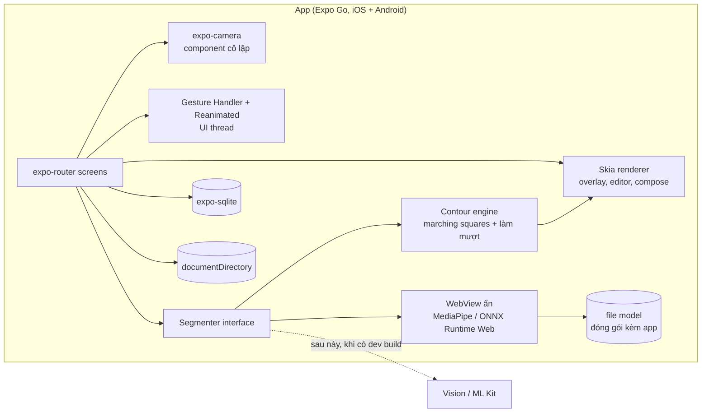

# TakeASnap — Roadmap rebuild

> Kế hoạch làm lại toàn bộ dự án: rút kinh nghiệm từ bản cũ, chốt kiến trúc mới và chia việc theo phase. Mỗi phase có tiêu chí hoàn thành đo được.
> Nghiệp vụ ở [business-flow.md](business-flow.md), giao diện ở [design.md](design.md).

---

## 0. Phạm vi đã chốt

| Câu hỏi | Quyết định | Hệ quả |
|---|---|---|
| Nền tảng | **iOS và Android, một codebase.** Test chính trên iPhone của bạn | Mọi thư viện phải chạy được trên cả hai nền tảng |
| Môi trường | **Windows + VS Code + Expo Go** | **Không có code native tự viết** (Swift/Kotlin), không cần Mac, không cần build |
| Mục đích | **Đồ án portfolio**, không phát hành store | Không cần Sentry, chính sách quyền riêng tư hay ảnh store. Thay vào đó cần video demo và bài viết case study |
| Ngân sách GPU | **Không có** | **Bỏ hẳn server.** App chạy 100% trên máy, kể cả Thay nền |
| Ngôn ngữ | **Chỉ tiếng Việt** | Không cài thư viện i18n; mọi chuỗi nằm trong `src/ui/strings.ts` |
| Ảnh pose mẫu | Dùng được (phi thương mại) | Model có license phi thương mại cũng dùng được, vẫn ghi nguồn |

### Vì sao Expo Go đủ

App vẫn là app native: React Native vẽ giao diện bằng view native của iOS và Android. Expo Go chỉ giới hạn ở chỗ **không nạp được code native tự viết**. Trong khi đó, các thư viện nặng mà dự án cần đều đã có sẵn trong Expo Go: Skia, Reanimated, Gesture Handler, Camera, SQLite, WebView, Sensors, Haptics.

Phần duy nhất cần native là **tách người**. Phần này chạy bằng một model segmentation trong **WebView ẩn** (WASM / WebGL). File model đóng gói kèm app nên vẫn chạy offline, và cùng một code chạy trên cả iOS lẫn Android.

### Đường nâng cấp sau này

Phần tách người đi qua interface `Segmenter` (§3.3). Khi có điều kiện dùng dev build, chỉ cần thay phần cài đặt bên dưới, phần còn lại giữ nguyên:
- **Android:** build được ngay trên Windows bằng Android Studio (`npx expo run:android`), dùng ML Kit.
- **iOS:** cần Mac, hoặc GitHub Actions macOS + Sideloadly, dùng Apple Vision.

---

## 1. Tóm tắt quyết định kỹ thuật

| Vấn đề cũ | Quyết định mới |
|---|---|
| Tách người phải gọi server qua LAN IP | **Tách người trên máy bằng model trong WebView ẩn** (MediaPipe hoặc ONNX Runtime Web). Không còn server |
| Code backend bị mất | Không cần backend nữa. Mọi thứ nằm trong một repo |
| Cử chỉ chồng chéo, giật | `react-native-gesture-handler` Gesture API + `react-native-reanimated` shared value, chạy trên UI thread. **Không có setState nào trong lúc cử chỉ đang diễn ra** (riêng zoom camera, xem §3.5) |
| Viền không đổi được độ dày | Viền vẽ từ **contour vector** bằng Skia, đổi độ dày và màu realtime |
| Thay nền chỉ dán ảnh lên | Pipeline Skia trên máy: mask mềm, khớp màu, relight giả lập, light wrap, bóng tiếp xúc và bóng đổ. Có **cổng quyết định** để cắt chức năng nếu không đạt (Phase 4) |
| Flash auto giả, crop sai | `expo-camera` dùng `flash="auto"` gốc; crop theo kích thước ảnh thật, không theo % màn hình |
| Điều hướng bằng `useState` trong `App.tsx` | **`expo-router`** |
| Lưu metadata bằng file JSON | **`expo-sqlite`**. File ảnh nằm trong `documentDirectory` |
| Ionicons + emoji | **Lucide** (`lucide-react-native`, chạy trên `react-native-svg`) |

---

## 2. Bài học từ bản cũ

Các lỗi đã đọc thấy trong code. Đây là danh sách phải tránh lặp lại, không phải danh sách cần sửa (bản cũ sẽ bị thay thế).

### 2.1 Camera — [CameraScreen.tsx](../src/screens/CameraScreen.tsx)

| # | Lỗi | Hậu quả |
|---|---|---|
| L1 | `PanResponder` tạo một lần trong `useRef`, đọc state `currentRotate` của lần render đầu (stale closure, luôn = 0) | Mỗi lần pinch, góc xoay nhảy về 0 |
| L2 | `scale.setValue(distance / initialPinchDistance)`, không nhân với scale trước đó | Mỗi lần pinch mới, overlay nhảy về cỡ gốc |
| L3 | `position.setValue({ x: dx, y: dy })`, không cộng offset cũ | Mỗi lần kéo, overlay nhảy về giữa |
| L4 | Kéo, pinch và xoay tự tính bằng tay trong một responder; zoom camera dùng `FlatList` riêng | Cử chỉ giành nhau, overlay giật |
| L5 | Zoom và accelerometer gọi `setState` liên tục (mỗi frame / mỗi 100 ms) ở component cha | Re-render cả màn, kể cả `CameraView` và overlay |
| L6 | Flash auto chụp một ảnh mỗi giây, độ sáng lấy từ `Math.random()`, bật/tắt **đèn pin** | Đèn nháy ngẫu nhiên, tốn pin |
| L7 | Crop cố định 15%–75% chiều cao preview, không tính tỉ lệ cảm biến và `cover` scaling | Ảnh lưu lệch so với khung đã thấy |

### 2.2 Pose — [SegmentUtils.ts](../src/components/SegmentUtils.ts), [SegmentStorage.ts](../src/components/SegmentStorage.ts), [SegmentEditor.tsx](../src/screens/SegmentEditor.tsx)

| # | Lỗi | Hậu quả |
|---|---|---|
| L8 | LAN IP `192.168.1.6` viết cứng | Chỉ chạy được trong mạng nhà |
| L9 | Ảnh lưu trong `cacheDirectory`, metadata trong `documentDirectory` | Hệ điều hành dọn cache thì pose mất ảnh, thư viện vỡ |
| L10 | `deleteSegment` không xóa file `outline` | Rò file |
| L11 | Viền là PNG từ server, chỉ `tintColor` được | Không đổi được độ dày |
| L12 | Kiểu `SegmentData` khai báo lặp ở 3 nơi | Lệch kiểu khi sửa |
| L13 | Pose mẫu phải gửi lên server tách lại mỗi lần chọn | Chậm, cần mạng cho cả ảnh mẫu |

### 2.3 Thay nền — [ChangeBackground.tsx](../src/screens/ChangeBackground.tsx)

| # | Lỗi | Hậu quả |
|---|---|---|
| L14 | `setFgX/setFgY` mỗi lần ngón tay di chuyển | Re-render mỗi frame |
| L15 | Pinch qua `onTouchMove` song song với `PanResponder` | Kéo và pinch giành nhau |
| L16 | Gửi tọa độ theo khung màn hình 500 px, trong khi nền hiển thị `contain` | Vị trí ghép lệch với preview |
| L17 | Response `/segment` ở màn này khác hẳn ở `SegmentUtils` | Hai hợp đồng API cho một endpoint |
| L18 | Chỉ dán ảnh lên nền | Không bóng, không khớp sáng, nhìn là biết ảnh ghép |

### 2.4 Giao diện

- Màu nhấn tím `#C259FF` và bảng màu phủ có tím (`#a5b4fc`, `#c4b5fd`). Design mới cấm tím, xem [design.md](design.md).
- Dùng emoji làm icon (📸 ✏️ 🗑️), trộn với Ionicons.
- Mỗi màn một kiểu nút và một màu xanh khác nhau (`#3b82f6`, `#0a84ff`, `#007bff`, `#2196f3`).
- Copy trộn Việt/Anh, có câu quảng cáo ("Ảnh đẹp lung linh"), nút chung chung ("Xác nhận").

---

## 3. Kiến trúc mới

### 3.1 Sơ đồ tổng

Toàn bộ chạy trên điện thoại, không có thành phần mạng.



### 3.2 Stack

Mọi thư viện dưới đây đều có sẵn trong Expo Go hoặc là JS thuần.

| Lớp | Chọn | Ghi chú |
|---|---|---|
| Runtime | Expo SDK **đúng bản mà Expo Go trên App Store đang hỗ trợ** | Expo Go chỉ chạy SDK mới nhất. Khi Expo Go cập nhật thì nâng SDK theo |
| Điều hướng | `expo-router` | |
| Camera | `expo-camera` | `flash="auto"` gốc, `mirror`, `selectedLens` (chọn ống góc rộng trên iOS) |
| Cử chỉ | `react-native-gesture-handler` v2 (Gesture API) | `Gesture.Simultaneous`, `Gesture.Exclusive`, bật/tắt theo chế độ |
| Animation | `react-native-reanimated` | Shared value, worklet |
| Vẽ | `@shopify/react-native-skia` (đã có trong `package.json`, bản cũ chưa dùng) | Overlay 3 lớp, editor, `RuntimeEffect` shader cho compose |
| Tách người | `react-native-webview` + model chạy trong WebView | Ứng viên ở §3.3 |
| Cảm biến | `expo-sensors` (Accelerometer) | Ghi vào shared value, không setState |
| State | `zustand` cho state phiên, SQLite cho dữ liệu lưu | |
| Lưu trữ | `expo-sqlite`, `expo-file-system`, `expo-media-library`, `expo-image-manipulator` | |
| Sheet | `presentation: 'formSheet'` của expo-router; dự phòng `@gorhom/bottom-sheet` | Kiểm tra trên Android ở Phase 0 |
| Font | `@expo-google-fonts/urbanist`, `@expo-google-fonts/dm-mono` | Theo deal ở design.md |
| Icon | `lucide-react-native` | Một bộ chung cho cả hai nền tảng |
| Haptics | `expo-haptics` qua `src/lib/haptics.ts` | Có trong Expo Go trên iOS (spike D); Android chưa đo |
| Chuỗi giao diện | `src/ui/strings.ts` | Chỉ tiếng Việt |
| Chất lượng | TypeScript strict, ESLint, Prettier, Jest cho logic thuần | |

### 3.3 Tách người — `Segmenter`

```ts
// src/engine/segmentation/types.ts
export type SegmentResult = {
  width: number;
  height: number;
  maskUri: string;   // PNG 1 kênh, alpha mềm, cùng kích thước ảnh đã chuẩn hóa
  regions: { bbox: [number, number, number, number]; areaRatio: number }[]; // các vùng người tách rời
};

export interface Segmenter {
  ready(): Promise<void>;                       // nạp model một lần
  segment(imageUri: string): Promise<SegmentResult>;
}

// Bản v1:      WebViewSegmenter   (Expo Go, iOS + Android)
// Sau này:     NativeSegmenter    (dev build: Vision trên iOS, ML Kit trên Android)
```

Cách `WebViewSegmenter` chạy:

1. Một `<WebView>` 1×1 px, ẩn, được mount một lần ở `app/_layout.tsx`. Trang HTML, thư viện JS, file `.wasm` và file model đều là asset trong app.
2. JS gửi ảnh đã hạ xuống **cạnh dài 1024 px** (base64) qua `postMessage`.
3. Trong WebView: chạy model → mask → làm mềm mép → encode PNG → trả base64 về.
4. JS ghi PNG vào `documentDirectory`, tìm các vùng người tách rời (connected components trên mask 256 px), rồi trả `SegmentResult`.

**Đã chốt sau spike B trên iPhone 15 Pro Max** (chi tiết ở [spikes.md](spikes.md#chốt-spike-b-iphone)):

| Dùng cho | Model | Thư viện | Đo trên iPhone |
|---|---|---|---|
| **Pose** | MediaPipe `selfie_multiclass_256x256` | `@mediapipe/tasks-vision` 1.1.1, GPU | ~105 ms cả vòng |
| **Thay nền** | RMBG-1.4 **fp16** (84 MB) | `onnxruntime-web` 1.30.0, **WebGPU** | ~0.96 s cả vòng |
| Thay nền, không có WebGPU | RMBG-1.4 int8 (42 MB) | `onnxruntime-web` 1.30.0, WASM 1 luồng | ~7.9 s cả vòng |

- Multiclass: lấy `1 − kênh nền` rồi kéo dãn [0.25, 0.65] → [0, 1] (kênh nền chỉ đạt 0.8–0.96 trên vùng nền).
- RMBG chỉ nhận đúng 1024 × 1024. **Không đưa bản int8 lên WebGPU**: lần đo 2 treo quá 180 s.
- Đã loại: MediaPipe Selfie (cắt mất chân, váy), DeepLab v3 (mép nhòe, dính nền), U²-Net human seg (176 MB).
- Đã thử và bỏ: guided filter làm mịn mép (quầng sáng, lem nền).
- **Còn phải quyết ở Phase 1:** đóng gói model kèm app (app nặng thêm ~85–130 MB, offline hoàn toàn) hay tải một lần khi dùng lần đầu (cần mạng một lần, không gửi ảnh đi). Lần đo đầu mất 24–37 s chủ yếu vì tải model.

Pose mẫu được tách sẵn trên Windows bằng `onnxruntime-node` hoặc Python, dùng cùng model đó (`scripts/build-sample-poses.ts`), nên chọn pose mẫu là dùng được ngay.

### 3.4 Contour và 3 lớp

1. Mask → hạ mẫu xuống cạnh dài 512 px → marching squares (`marchingsquares` đã có trong deps) → danh sách contour, có phân biệt lỗ (khe giữa tay và thân).
2. Đơn giản hóa bằng Douglas–Peucker (ε ≈ 0.75 px), rồi làm mượt bằng Catmull–Rom → `SkPath`.
3. Lưu điểm dưới dạng tọa độ chuẩn hóa 0..1, dùng được ở mọi kích thước.
4. Vẽ 3 lớp trong **một `<Canvas>` Skia**:
   - Người: `Image` với `opacity`.
   - Phủ: mask làm alpha, `BlendMode.SrcIn` với màu phủ, `opacity`.
   - Viền: `Path` stroke, `strokeWidth = outlineWidth / overlayScale` để độ dày trên màn hình không đổi khi zoom.
5. Mọi giá trị style là **shared value** truyền thẳng vào Skia. Kéo slider không gây re-render React.

### 3.5 Hệ cử chỉ

Gesture Handler 3.3 (bản đi kèm SDK 58) dùng **API hook**; builder `Gesture.Pan()` đã deprecated. Code thật ở [src/gestures/useTransformGesture.ts](../src/gestures/useTransformGesture.ts), toán tách riêng ở [transformMath.ts](../src/gestures/transformMath.ts) và có unit test.

```ts
// Chế độ chỉnh overlay (editMode = true)
const pan    = usePanGesture({ enabled: editMode, onUpdate: (e) => { 'worklet'; tx.value += e.changeX; ty.value += e.changeY; } });
const pinch  = usePinchGesture({ enabled: editMode, onUpdate: (e) => { 'worklet'; /* scaleAbout(t, focal, e.scaleChange) */ } });
const rotate = useRotationGesture({ enabled: editMode, onUpdate: (e) => { 'worklet'; /* rotateAbout(t, anchor, e.rotationChange) */ } });
const reset  = useTapGesture({ enabled: editMode, numberOfTaps: 2, onActivate: () => { 'worklet'; resetTo(initial); } });
const overlayGesture = useExclusiveGestures(reset, useSimultaneousGestures(pan, pinch, rotate));

// Chế độ chụp (editMode = false)
const camZoom = usePinchGesture({ enabled: !editMode, onUpdate: (e) => { 'worklet'; zoomSV.value = clamp(zoomSV.value + (e.scaleChange - 1) * 0.6); } });
```

Sang JS chỉ bằng `scheduleOnRN` của `react-native-worklets` (thay cho `runOnJS`), và chỉ khi cử chỉ kết thúc.

Quy tắc:
- Mọi phép biến đổi **cộng dồn** bằng `changeX`, `scaleChange`, `rotationChange`. Không tính lại từ điểm đầu.
- Pinch neo theo **tâm hai ngón**: điểm dưới ngón tay đứng yên khi phóng to.
- Cử chỉ chỉnh overlay nhận trên **toàn khung ngắm**, không chỉ trên vùng overlay, nên pose nhỏ vẫn chỉnh được.
- Chỉ gọi `scheduleOnRN` khi cử chỉ **kết thúc** (lưu placement, haptics).
- Hít góc 0°/90° khi lệch dưới 3°. Giới hạn scale 0.2×–4×.
- Cùng một hook `useTransformGesture` dùng cho overlay camera và cho bước Vị trí của Thay nền.

**Ngoại lệ: zoom camera.** `expo-camera` nhận zoom qua prop, nên bắt buộc phải có state. Cách làm:
- `CameraView` nằm trong một component riêng, `React.memo`, chỉ nhận `zoom` và vài prop camera. Overlay, lưới và thanh điều khiển nằm **ngoài** component này.
- Shared value `zoomSV` đẩy sang state bằng `useAnimatedReaction` + `runOnJS`, giới hạn khoảng 30 lần/giây.
- Chỉ component camera re-render; overlay không bị ảnh hưởng.

### 3.6 Thay nền — pipeline trên máy

Không có server, nên phần "relight bằng model diffusion" được thay bằng **relight giả lập**. Mục tiêu là ảnh **trông tự nhiên ở mức portfolio**, không nhắm tới mức của các model GPU. Toàn bộ chạy bằng Skia (`RuntimeEffect` shader + đọc pixel ảnh thu nhỏ).

| Bước | Cách làm |
|---|---|
| 1. Mask mềm | Model mép đẹp (§3.3); feather thêm 1–2 px ở mép |
| 2. Phân tích nền | Thu nền xuống 256 px, đọc pixel: trung bình và độ lệch chuẩn Lab, lưới sáng 8×8 (ước lượng hướng sáng), mức mờ (phương sai Laplacian), mức nhiễu |
| 3. Mặt đất | Mặc định: vùng dưới đường chân trời ước lượng. Tùy chọn: model độ sâu nhỏ trong WebView (Depth Anything V2 Small, lượng tử hóa), chỉ làm nếu còn thời gian |
| 4. Khớp màu | Chuyển thống kê Lab của người về phía nền (Reinhard), slider 0–100% |
| 5. Relight giả lập | Gradient sáng/tối trên người theo hướng sáng, nhân với mask; thêm rim light mảnh ở mép phía nguồn sáng, màu lấy từ vùng sáng nhất của nền |
| 6. Light wrap | Làm mờ nền rồi tràn nhẹ vào mép người, 4–12 px |
| 7. Bóng tiếp xúc | Bóng elip mềm dưới điểm thấp nhất của mask |
| 8. Bóng đổ | Chiếu silhouette theo hướng sáng lên mặt đất (skew + scale Y), làm mờ dần theo khoảng cách, độ đậm theo độ tương phản của nền |
| 9. Khớp độ nét và nhiễu | Làm mờ người theo mức mờ của nền; thêm grain theo mức nhiễu |
| 10. Xuất | Skia offscreen (`makeImageSnapshot`), độ phân giải gốc của ảnh nền, tối đa 12 MP |

Người dùng chỉnh được: hướng sáng (vòng xoay, mặc định là giá trị ước lượng), độ mềm và độ đậm bóng, mức khớp màu.

### 3.7 Cấu trúc thư mục

```
src/
  app/                        # expo-router (SDK 58 đặt route trong src/app)
    _layout.tsx               # font, cử chỉ, SQLite; sau này mount WebView segmenter
    index.tsx                 # Camera (Phase 0: menu spike)
    library.tsx               # Thư viện pose (formSheet)
    editor/[poseId].tsx       # Chỉnh pose
    compose/
      _layout.tsx             # stepper 4 bước
      subject.tsx  background.tsx  place.tsx  result.tsx
    settings.tsx
    spike/                    # màn đo của Phase 0, xóa khi xong Phase 2
  features/
    camera/                   # CameraLayer (memo), controls, overlay, capture
    pose/                     # library, editor, repository
    compose/                  # placement, analysis, skia pipeline
  engine/
    segmentation/             # types.ts, WebViewSegmenter.tsx, web/ (HTML + JS chạy trong WebView)
    contour.ts                # marching squares, DP, Catmull–Rom (có unit test)
    image.ts                  # chuẩn hóa EXIF, resize
  gestures/useTransformGesture.ts
  lib/haptics.ts              # rung, tự tắt nếu Expo Go thiếu module
  ui/
    tokens.ts                 # màu, chữ, khoảng cách, radius, motion (dữ liệu thuần)
    easing.ts                 # hàm easing dựng từ token
    strings.ts                # mọi chuỗi tiếng Việt
    components/               # Button, IconButton, Slider, Segmented, Swatch, Screen...
  db/                         # schema + migration SQLite
  store/                      # zustand
assets/
  models/                     # file model (.onnx / .tflite) + .wasm
  poses/
    source/                   # 25 ảnh mẫu gốc (chuyển từ src/assets/images của bản cũ)
scripts/build-sample-poses.ts # thay cho src/components/samplesGenerate.js
metro.config.js               # thêm assetExts: onnx, tflite, wasm
docs/
```

---

## 4. Các phase

Ước lượng cho **1 người làm, full-time**. Mỗi phase kết thúc bằng một bản chạy được trong Expo Go trên iPhone, và đã kiểm tra trên Android.

### Phase 0 — Nền móng và spike (1–2 tuần)

- [x] Môi trường Windows: nvm-windows + Node 24.22.2 (SDK 58 cần Node ≥ 22.13), VS Code, Git
- [x] Expo Go trên iPhone 15 Pro Max (iOS 26) và emulator Pixel 8a (Android Studio)
- [x] Tag bản cũ `legacy-v0`, làm rebuild trên nhánh `rebuild`
- [x] **Push lên GitHub** (tag `legacy-v0` + nhánh `rebuild`)
- [x] Khởi tạo project mới: Expo SDK 58, RN 0.88, TypeScript strict, ESLint, Prettier, Jest, `expo-router`
- [x] **Spike A — camera:** `CameraLayer` cô lập + pinch zoom qua shared value *(iOS: UI 60 / JS 55–58. Android emulator: UI 58–60 / JS ~35 sau khi giới hạn zoom 30 lần/giây)*
- [x] **Spike B — tách người:** 4 model trong WebView *(chốt ở §3.3: Multiclass cho pose, RMBG fp16 WebGPU cho Thay nền. Android emulator: GPU đọc mask ra 0 → tự lùi CPU; không có WebGPU → RMBG CPU ~9 s)*
- [x] **Spike C — Skia overlay:** viền + phủ + ảnh trên 1 canvas, slider độ dày ở 60 fps *(iOS và Android emulator: UI ≥ 58)*
- [x] **Spike D — giới hạn Expo Go:** album, haptics, `formSheet` *(iOS 5/5. Android: haptics có, sheet tốt; lưu album lỗi quyền AUDIO → đã sửa, chờ đo lại)*
- [x] `src/ui/tokens.ts`, `src/ui/strings.ts` và component nền: Button, IconButton, Slider, Segmented, Swatch, Screen (sheet dùng `formSheet` của expo-router)
- [x] `useTransformGesture` + toán biến đổi có unit test (dùng lại ở Phase 2 và Phase 4)
- [x] Schema SQLite v1 + migration
- [x] CI: typecheck + lint + unit test (GitHub Actions)

**Xong khi:** 4 spike có số đo ghi vào `docs/spikes.md`; đã chọn model cho pose và cho Thay nền.

**Trạng thái:** đạt. Còn hai việc nhỏ không chặn Phase 1: đo lại lưu album trên Android sau khi sửa quyền; và khi có máy Android thật, kiểm tra WebView có WebGPU không (quyết định Thay nền ~1 s hay ~9 s trên Android).

### Phase 1 — Pose engine và Chỉnh pose (2–3 tuần)

- [ ] `WebViewSegmenter` hoàn chỉnh: nạp model một lần, chuẩn hóa ảnh, mask, tìm vùng người, xử lý lỗi và hết thời gian
- [ ] `engine/contour.ts` có unit test (hình tròn, hình có lỗ, nhiều vùng)
- [ ] Màn Chỉnh pose: 3 lớp, mọi điều khiển ở [business-flow §5.2](business-flow.md#52-màn-chỉnh-pose--3-lớp-và-các-điều-khiển), trừ Sửa nét
- [ ] Repository pose: tạo, sửa, xóa (xóa sạch file)
- [ ] `scripts/build-sample-poses.ts`: tách sẵn 25 ảnh trong `src/assets/images/*`, đóng gói mask + contour

**Xong khi:** chọn ảnh → có pose trong dưới 4 s trên iPhone (mục tiêu, sẽ chỉnh theo spike B); mọi slider đổi hình ngay trong frame kế tiếp; độ dày viền đổi được từ 1 đến 12 px.

### Phase 2 — Camera và overlay (2–3 tuần)

- [ ] `expo-camera`: đổi camera, flash gốc 3 chế độ, tỉ lệ 3:4 / 9:16 / 1:1, chip zoom + pinch, hẹn giờ
- [ ] Lưới 3×3 / 4×4, thước cân bằng (accelerometer → shared value)
- [ ] Overlay Skia + `useTransformGesture`, hai chế độ chụp / chỉnh
- [ ] Điều khiển nhanh: độ hiện, lật ngang, giữ để ẩn, gỡ pose
- [ ] Chụp: crop đúng vùng khung ngắm theo kích thước ảnh thật (sửa L7), lưu album, thumbnail
- [ ] Nhớ placement theo từng pose (BR-10)

**Xong khi:** đạt hết ma trận cử chỉ dưới đây trên iPhone và Android, không rơi frame nhìn thấy được.

| Test | Kỳ vọng |
|---|---|
| Kéo, thả, kéo tiếp | Đi tiếp từ chỗ thả |
| Pinch 2 lần liên tiếp | Lần 2 bắt đầu từ cỡ của lần 1 |
| Xoay 2 lần liên tiếp | Lần 2 bắt đầu từ góc của lần 1 |
| Pinch và xoay cùng lúc | Cả hai cùng chạy, không giật |
| Pinch ở chế độ chụp | Chỉ zoom camera, overlay đứng yên |
| Pinch ở chế độ chỉnh | Chỉ đổi overlay, zoom đứng yên |
| Kéo vào vùng xóa | Rung một lần, thả thì gỡ overlay |
| Ảnh lưu so với khung | Mép ảnh trùng mép khung, sai số dưới 1% |

### Phase 3 — Thư viện pose và Sửa nét (1–2 tuần)

- [ ] Màn Thư viện: Pose mẫu theo nhóm, Pose của bạn, Thêm ảnh từ máy
- [ ] Chọn người khi ảnh có nhiều người (chạm vào vùng người)
- [ ] Sửa nét: cọ thêm / xóa trên mask, hoàn tác 30 bước, tính lại contour khi nhấc tay
- [ ] Tạo bản sao từ pose mẫu, xóa có xác nhận
- [ ] Trạng thái rỗng, đang xử lý, lỗi theo [business-flow §10](business-flow.md#10-trạng-thái-và-lỗi)

**Xong khi:** chức năng 1 + 2 chạy trọn vẹn ở chế độ máy bay. **Đây là mốc portfolio tối thiểu:** dừng ở đây vẫn có một app hoàn chỉnh để trình bày.

### Phase 4 — Thay nền (timebox 3 tuần, có cổng quyết định)

- [ ] Phân tích nền (§3.6 bước 2–3)
- [ ] Stepper 4 bước, bước Vị trí dùng `useTransformGesture`
- [ ] Pipeline Skia 10 bước, preview tức thì ở độ phân giải màn hình
- [ ] Vòng chỉnh hướng sáng, độ mềm/đậm bóng, mức khớp màu
- [ ] Xuất độ phân giải gốc (tối đa 12 MP), giữ để so sánh với ảnh trước khi xử lý, lưu album
- [ ] Bộ ảnh test: 30 cặp người/nền (trong nhà, ngoài trời nắng, ngoài trời râm, đêm)

**Cổng quyết định ở cuối tuần 2:** chấm 10 cặp theo 6 tiêu chí ở [business-flow §6.1](business-flow.md#61-mục-tiêu-chất-lượng), 3 người chấm không biết trước ảnh nào là ghép.

| Điểm trung bình | Quyết định |
|---|---|
| ≥ 3/5 | Làm tiếp tuần 3, hoàn thiện |
| 2–3/5 | Thu hẹp phạm vi: chỉ giữ cảnh **ngoài trời râm và trong nhà** (ánh sáng mềm, dễ khớp); app gợi ý chọn nền có ánh sáng mềm |
| < 2/5 | **Bỏ chức năng Thay nền.** Ghi lại thử nghiệm vào case study (đã thử gì, vì sao chưa đạt), chuyển sang Phase 5 |

**Xong khi:** đạt ≥ 3/5 trên cả 30 cặp (hoặc phạm vi đã thu hẹp); xuất ảnh dưới 5 s.

### Phase 5 — Hoàn thiện portfolio (1–2 tuần)

- [ ] Hiệu năng: mở app tới khi thấy preview dưới 2 s; bộ nhớ ổn định khi mở ảnh 12 MP
- [ ] Accessibility: nhãn cho mọi nút icon (VoiceOver, TalkBack), cỡ chữ hệ thống, tôn trọng Reduce Motion
- [ ] Icon app, splash
- [ ] **Video demo** 60–90 s quay trên iPhone: chọn pose → chỉnh → chụp theo → (thay nền); thêm vài giây trên Android để chứng minh chạy hai nền tảng
- [ ] **Case study** trong README: vấn đề của bản cũ, cách sửa hệ cử chỉ, contour vector, tách người offline bằng WebView, pipeline thay nền, số đo trước/sau
- [ ] Ảnh/GIF trước–sau cho từng chức năng
- [ ] Ghi nguồn ảnh mẫu và license model trong README
- [ ] (Tùy chọn) `eas update` để người xem mở app bằng Expo Go qua link/QR mà không cần clone repo

**Xong khi:** người xem repo hiểu app làm gì trong 30 giây đầu và xem được demo mà không cần cài app.

### Sau v1 (backlog)

- `NativeSegmenter` qua dev build: ML Kit trên Android (build được trên Windows), Apple Vision trên iOS (cần Mac hoặc GitHub Actions + Sideloadly)
- `react-native-vision-camera` thay `expo-camera`: zoom không qua state, chạm lấy nét, frame processor
- Điểm khớp dáng realtime: ước lượng tư thế người thật, so với pose mẫu, hiện % khớp
- Gợi ý vị trí đứng trong Thay nền dựa trên độ sâu
- Chia sẻ pose qua file `.tasnap`

---

## 5. Rủi ro

| Rủi ro | Khả năng | Ứng phó |
|---|---|---|
| Model trong WebView chậm trên iPhone | **Đã loại** (spike B) | Multiclass ~105 ms, RMBG fp16 WebGPU ~0.96 s trên iPhone 15 Pro Max |
| Android WebView không có WebGPU, hoặc GPU đọc mask sai | Trung bình (emulator bị cả hai) | MediaPipe tự lùi CPU (~0.3 s); RMBG lùi int8 WASM (~9 s), Thay nền trên Android chậm hơn nhưng vẫn chạy |
| WebView tốn bộ nhớ khi gửi ảnh base64 lớn | Trung bình | Giới hạn 1024 px cho pose; Thay nền tách ở 1024 px rồi phóng mask lên bằng làm mịn có hướng dẫn theo ảnh gốc |
| Mask kém với người toàn thân ở xa | Trung bình | So 4 model ở spike B; với pose thì mask thô vẫn đủ vì chỉ dùng làm dáng |
| Expo Go chỉ chạy SDK mới nhất | Chắc chắn | Khi App Store cập nhật Expo Go thì nâng SDK; không dùng thư viện ngoài danh sách của Expo Go |
| Expo Go trên Android giới hạn quyền thư viện ảnh | Trung bình | Spike D; dự phòng: lưu bằng `saveToLibraryAsync` không cần album riêng |
| Zoom camera qua state làm giật overlay | Thấp–trung bình | `CameraLayer` cô lập (§3.5); spike A |
| Thay nền trên máy không đủ tự nhiên | **Cao** | Cổng quyết định ở Phase 4; Phase 3 đã là mốc portfolio tối thiểu |
| Mất code lần nữa | Đã xảy ra | Push lên GitHub từ ngày đầu; CI chạy trên mỗi push |
